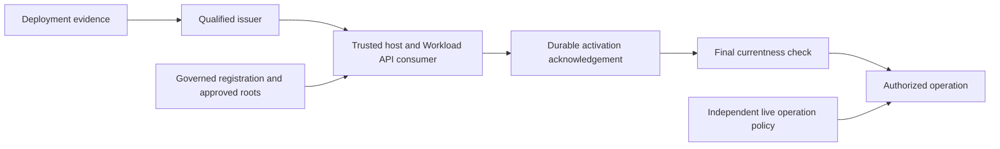

# Workload identity and portable trust

A workload identity identifies a running program. It lets a service establish
which process is connecting before deciding what that process may do. In Trogon,
the trusted host or service holds this identity. An AI model, a prompt and an
application identifier do not receive authority merely by naming a workload.

This explanation describes the foundation in repository `main` at
[`8d541e6`](https://github.com/TrogonStack/trogonai/tree/8d541e6a868e9016405b3846db56bb5b983243a0),
reviewed on 2026-11-09, and the proposed direction around it.
[ADR#0098](../adr/0098-attested-workload-identity.md) remains draft.
The [runtime reference](../reference/workload-identity.md) records implemented
behavior and deployment acceptance gates. The
[research proposals](../research/workload-identity/README.md) describe the
federation and adapter work still needed.

## Identity, attestation and authorization

These concepts answer different questions:

| Concept | Question it answers | Trogon boundary |
| --- | --- | --- |
| Application `AgentId` | Which logical application agent is this? | Application identity and governance under draft [ADR#0036](../adr/0036-agent-self-certifying-identity.md) and [ADR#0037](../adr/0037-agent-identity-governance.md). It is not evidence about the current process. |
| Runtime attestation | Which node and workload are requesting credentials? | A qualified issuer checks deployment-specific evidence and constrained registration. Node admission and workload admission are separate. |
| SPIFFE ID | Which workload name does the issuer attest to? | A namespaced URI such as `spiffe://example.org/workload/worker`. Its path cannot choose a tenant, project, role or `AgentId`. |
| SVID | What credential proves the SPIFFE identity? | An X.509 certificate and matching private key in the implemented consumer profile. JWT-SVID acquisition is separate proposed work. |
| Governed registration | What platform identity may this attested workload represent? | An exact, versioned mapping with approved roots, finite validity and an independently controlled recovery fence. |
| Authorization | What operation may it perform now? | Current tenant/project policy, destination permits and, where applicable, Connection grants and purpose constraints. |

A certificate with a valid signature can still belong to an unregistered
workload. A registered workload can still lack permission for a destination.
An application signing key can establish application identity without proving
which runtime possesses it. Keeping these checks separate prevents a copied
key, a chosen URI or a valid foreign certificate from creating platform access.

## What SPIFFE and SPIRE do

SPIFFE defines workload identifiers, credential formats, the Workload API and
federation protocols. SPIRE is the issuer implementation selected by the
current draft deployment profile. The portability proposal keeps the standard
boundary while requiring equivalent evidence before qualifying another issuer.

| Component | Responsibility |
| --- | --- |
| SPIRE Server | Governs its trust domain, registration and signing authority; issues credentials through the selected attestation and key-management configuration. |
| SPIRE Agent | Runs near workloads, proves its node identity and attests local callers before serving the Workload API. This infrastructure process is different from a Trogon application agent. |
| Trusted workload host | Consumes the privileged Workload API, protects the delivered private key and uses current material for authenticated operations. |
| Trogon authority owners | Approve platform mappings, acknowledge activation, authorize operations, withdraw grants and govern recovery. |

The repository contains consumer, registration, egress and deployment-rendering
foundations. That does not establish that a SPIRE Server or Agent is running in
a particular environment. Issuer deployment, signer custody, isolation,
failover and restore require evidence from that environment.

The proposed self-hosted development profile uses local Linux attestation and
does not need AWS, GitHub or Kubernetes. Production support additionally needs
an accepted bootstrap/custody profile and operational qualification.

## How a workload becomes usable

The implemented X.509 path composes issuer evidence with platform authority:

1. The deployment issuer attests the node and workload under constrained
   registration. A workload cannot select its own admitted tenant identity.
2. The trusted host consumes its exact configured SPIFFE identity over the
   Unix Workload API. Trogon validates the SVID, matching key, certificate path
   and approved root fingerprints.
3. A governed registration maps the authenticated identity to its platform
   scope and role. The URI path does not supply that mapping.
4. Candidate material becomes usable only after durable activation audit is
   acknowledged and source, registration and trust generations are checked
   again.
5. Each operation still requires current authorization. Egress checks the
   exact destination and retains the material and policy deadlines while
   connecting and forwarding.
6. Rotation or withdrawal invalidates captured material and affected sessions.
   An expired original grant cannot become fresh merely because a new token
   or certificate arrives.

The consumer imposes a one-hour certificate lifetime ceiling. Its material
lease ends at the earlier certificate-path expiry or governed registration
deadline, with a registration lifetime ceiling of 330 seconds. These are local
bounds, not a promise about a third party's token lifetime.

The signed registration producer and administrative runner already exist.
The runner verifies independent approvals; it does not hold their signing key
or renew a prior approval automatically. The authoritative live egress-policy
publisher and independent recovery governance remain implementation and
deployment work. A healthy consumer alone does not supply those owners.

Private keys and provider credentials stay in the trusted execution/custody
boundary. They do not belong in model context, guest tool results, durable
events or diagnostic logs. A process that can access the privileged Workload
API is inside the identity security boundary and needs appropriate isolation.

## Portability and adapter boundaries

The proposed design keeps application identity, platform authorization and
opaque secret/key references independent of environment vendors. Kubernetes,
AWS, Google Cloud, Azure and GitHub integrate through selected profiles.

| Integration | What it can contribute | What it does not replace |
| --- | --- | --- |
| Kubernetes | Node/workload attestation inputs and deployment isolation. | Trogon registration, tenant mapping and operation policy. |
| Cloud infrastructure | Optional node evidence, issuer key custody, OpenBao seal or resource credentials. | The common identity contract or platform authorization. Each use has its own profile. |
| GitHub Actions OIDC | A verified external CI-job subject admitted for limited platform operations. | Local runtime attestation, automatic SVID enrollment or person consent. |
| SPIFFE federation | Authentication of explicitly trusted foreign-domain identities. | Tenant membership or destination permission. |
| KMS adapter | Cryptographic operations under an exact key binding. | Workload attestation, secret storage or issuer registration. |

SPIRE's CA key manager, OpenBao's auto-unseal key and a tenant's business KMS
key are different responsibilities. Bootstrap keys must be provisioned before
the services they unlock. Resolving an issuer's bootstrap key through a
service that first requires that issuer's credentials creates a startup cycle.

OpenBao remains the default secret store under accepted
[ADR#0023](../adr/0023-secret-management-and-key-custody-direction.md).
Draft [ADR#0030](../adr/0030-customer-controlled-key-backend-routing.md)
proposes OpenBao Transit, AWS KMS and Google Cloud KMS wrapping adapters;
their schemas and console state do not establish a running KMS service.
Accepted [ADR#0074](../adr/0074-credential-platform-extraction-boundary.md)
still requires extracting the gateway's provider client into the secrets owner.

Production portability has an explicit decision dependency: accepted
[ADR#0052](../adr/0052-cloud-kms-production-seal.md) currently mandates cloud
KMS auto-unseal for production OpenBao, with a recorded restricted-egress
exception. The proposed independently operated production profiles need a
formal amendment or supersession. A development profile cannot satisfy that
production decision by implication.

## What federation means here

Federation can cross different boundaries. Naming the direction avoids
mistaking one integration for another:

| Direction | Authentication | Independent authority decision |
| --- | --- | --- |
| Foreign SPIFFE domain to Trogon | Validate against the exact foreign domain's approved bundle. | Map the foreign subject to an admitted platform scope, then authorize its operation. |
| External OIDC workload to Trogon | Verify configured issuer, audience, subject and profile claims. | Admit limited platform operations under a governed binding. Local SVID enrollment remains separate. |
| Trogon workload to external resource | Obtain a recipient-specific assertion or use a qualified certificate exchange. | Select the exact provider account/role/resource under current platform grants and the recipient's policy. |

SPIFFE federation is directional and does not imply transitive trust. Never
pool foreign roots: an authority for one domain must not authenticate an
identity claiming another. The existing bundle parser is a foundation, not an
operational federation control plane.

SPIRE already provides JWT issuance options and an OIDC discovery helper.
The [federation proposal](../research/workload-identity/federation.md)
evaluates reuse before creating another assertion issuer. The helper publishes
public keys and discovery; Trogon still owns grants, custody and live use checks.

Provider credentials can outlive local authority. For example, AWS
`AssumeRoleWithWebIdentity` has a 900-second minimum session while the current
local registration ceiling is 330 seconds. A trusted broker can stop local use
after withdrawal, but cannot claim that AWS has revoked an already-issued
credential. JWT-SVIDs are bearer credentials unless a separate holder binding
is specified and enforced by the actual resource path.

## Where the work goes next

The [adapter roadmap](../research/workload-identity/adapter-roadmap.md)
records ADR reconciliation, service extraction, signing custody, environment
qualification, wrapping backends and operational acceptance.
The recommended federation milestone is a real exchange between local SPIRE
trust domains, including unauthorized-peer refusal, root rotation/removal and
active-session withdrawal. Cloud-specific exchanges follow as optional
profiles with their own proofs.

For configuration and exact limits, use the
[runtime reference](../reference/workload-identity.md) and
[deployment procedure](../how-to/deploy-workload-identity.md).
Neither a draft ADR nor rendered deployment configuration establishes
production readiness.
