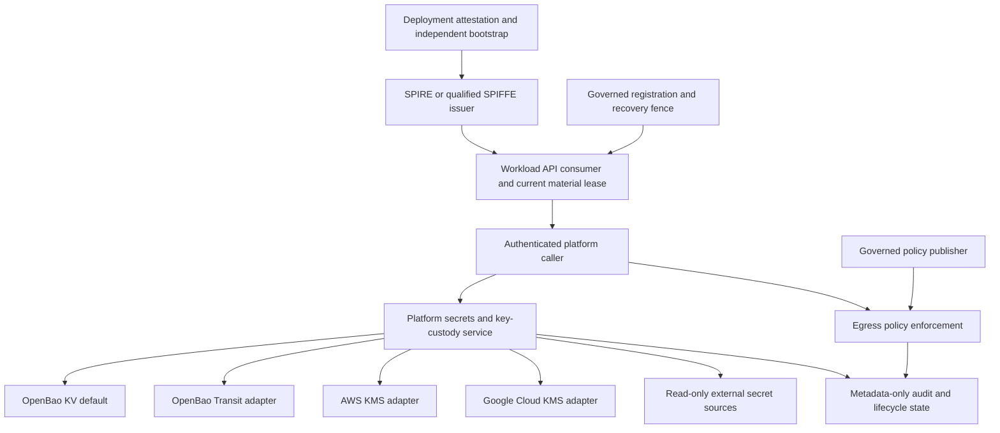

# Portable identity and key-custody adapter roadmap

Status: research proposal. This roadmap organizes design decisions and implementation work;
it does not accept an ADR or establish deployed adapter support.

Source baseline: repository `main` at
[`8d541e6`](https://github.com/TrogonStack/trogonai/tree/8d541e6a868e9016405b3846db56bb5b983243a0),
reviewed on 2026-11-09. Implementation observations below apply to that baseline. Refresh
the inventory and decision statuses before implementation. SPIRE upstream references use the
release commit selected by the deployment code, `872c1d55b4d5ac7fc1bf05f0760f2ca740ab37aa`.

Start with the [workload identity explanation](../../architecture/workload-identity.md) for
terminology and the [federation proposal](./federation.md) for trust-domain, inbound and
outbound protocols. Work-package identifiers here are planning references, not reserved ADR
numbers or approved API names.

## Foundation now present in the source tree

The configuration protobufs are mapped in the
[configuration contract reference](../../reference/workload-identity-configuration.md).
The provider-independent Rust wrapping values, segregated operation ports and
in-memory conformance harness are mapped in the
[wrapping contract](../../reference/key-wrapping.md). This is the domain portion
of P13, not complete service integration or real-provider conformance.

The main-source inventory below remains pinned to the research baseline.
New domain and schema foundations do not establish a secrets-service cutover,
protected configuration controllers, native federation or production support.
Existing registration/identity operations are described in the
[registration procedure](../../how-to/operate-workload-registration.md) and
[trusted-host integration guide](../../how-to/integrate-workload-identity.md).

## Intended outcome

Make Trogon's application identity, governed authority, secret references, key references,
authorization, audit, and failure semantics portable. Kubernetes, AWS, Google Cloud, Azure,
GitHub, and individual issuers integrate through explicit supported profiles. A deployment
enables its reviewed subset; application code does not acquire a provider SDK or silently
change behavior when infrastructure changes.

The first useful outcome is a self-hosted nonproduction vertical slice that does not require
an AWS account, GitHub identity, or Kubernetes. Production portability additionally needs a
reviewed bootstrap/seal/signing profile. Existing accepted
[ADR#0052](../../adr/0052-cloud-kms-production-seal.md) prevents calling production cloud
independence complete today.

Maintain the existing OpenBao default for secret storage. Support multiple cryptographic key
backends under the already drafted KMS contract. Do not expand this into a generic plugin
marketplace or arbitrary provider-command endpoint.

## What the reviewed main contains

| Area | Current evidence | Consequence for planning |
| --- | --- | --- |
| Secret storage | Segregated gateway `SecretStore*` traits and OpenBao KV v2 implementation. `OpenBaoSecretStore` holds address, token, and HTTP client; gateway construction still calls it. | Reuse the existing write model and ports; complete accepted [ADR#0074](../../adr/0074-credential-platform-extraction-boundary.md) extraction instead of creating another store. |
| Opaque credential identity | The OpenBao adapter constructs provider-shaped `openbao:...` IDs. | Coordinate the existing opaque-ID migration before changing credential identity or moving streams. Preserve one owning migration. |
| KMS domain and service | [ADR#0030](../../adr/0030-customer-controlled-key-backend-routing.md), [ADR#0033](../../adr/0033-key-custody-product-model.md), architecture guides, protobuf contracts, validation fixtures, and console domain/fake state exist. The Rust workspace has no `trogon-key-management` or cloud KMS runtime adapter at this baseline. | Schema and UI presence are not service implementation. Start with an authoritative implementation inventory. |
| Key provider schema | `KeyProvider` names OpenBao Transit, AWS KMS, and Google Cloud KMS. `KeyCapability` currently declares envelope wrapping only. | Azure KMS, signing, HMAC, and PKCS#11 cannot be advertised as already supported. Additional capabilities need explicit decisions and schema evolution. |
| Signing | Audit has `CheckpointSigner` and a local signer. Callout supports env/file custody; vault source returns `VaultNotConfigured`. | Preserve operation-specific signer seams. Do not assume an implemented remote signing service. |
| Workload identity | Unix Workload API consumer, exact governed mappings, finite material leases, activation audit, rotation/withdrawal, and egress integration exist. | Reuse these owners; do not build another enrollment or platform CA. A SPIFFE string or certificate alone remains insufficient authority. |
| Registration | Signed registration producer and Unix administrative runner exist. Runner holds approval verification keys, not approval signing keys, and does not renew approval automatically. | Approval-controller custody and independent recovery governance remain work; do not rebuild the producer. |
| Egress policy | Authenticated scoped live-policy reader and generation-bound enforcement exist. Reference explicitly excludes the authoritative publisher and durable external recovery fence. | Build the missing governed publisher, separate from registration publication. |
| Issuer deployment | SPIRE renderer, PSAT/Kubernetes attestation, AWS KMS profile, policies, schemas, and artifact verification gates exist. | This is one deployment profile. No running SPIRE or production acceptance follows from rendering or local tests. |
| External federation | [ADR#0053](../../adr/0053-external-oidc-federation-surface.md) and [ADR#0098](../../adr/0098-attested-workload-identity.md) describe provider trust and credential exchange. | Implement and prove each issuer/recipient direction separately; do not label ordinary artifact signature verification federation support. |
| External secret sources | Draft [ADR#0079](../../adr/0079-external-secret-sources.md) names AWS Secrets Manager, Google Secret Manager, and customer OpenBao KV. No external-source runtime adapter was found in main. | They are read-only sources behind `SecretRef`, not replacements for the platform store and not KMS adapters. |
| Connector composition | The connection model and its custody/use contracts in [ADR#0092](../../adr/0092-third-party-connection-model.md) through [ADR#0097](../../adr/0097-github-app-installation-lifecycle.md) remain drafts. | Do not infer a complete runtime connector or federation service from those contracts. Preserve explicit unsupported boundaries until implementation and acceptance are complete. |

## ADR findings that must lead the work

| Record | Status at baseline | Preserve | Proposed action |
| --- | --- | --- | --- |
| [ADR#0000](../../adr/0000-adr-process.md) | accepted | Formal independent maintainer signoff is needed for acceptance. | Give every decision an explicit disposition; do not mark drafts accepted as a side effect of implementing them. Assign new numbers only against then-current main. |
| [ADR#0023](../../adr/0023-secret-management-and-key-custody-direction.md) | accepted | OpenBao default; distinct storage/crypto boundaries; sole application secrets-service provider client; reference-only consumers. | Clarify that the default store is retained while [ADR#0030](../../adr/0030-customer-controlled-key-backend-routing.md) expands key-backend choices. Scope any infrastructure issuer-client exception explicitly rather than weakening the rule globally. |
| [ADR#0030](../../adr/0030-customer-controlled-key-backend-routing.md) | draft | Built-in OpenBao/AWS/GCP envelope wrapping, immutable bindings, exact provider participation, no backend fallback. | Resolve draft acceptance and its relationship to later [ADR#0083](../../adr/0083-sealed-content-envelope.md) before product support claims. Preserve all-provider conformance as the completion gate. |
| [ADR#0033](../../adr/0033-key-custody-product-model.md) | draft | Tiers describe ownership/dedication, not vendor; bootstrap keys outside business KMS; business purposes remain distinct. | Resolve custody for CA, approval, checkpoint, and protocol signing separately. Define production profiles without putting bootstrap keys behind services they unlock. |
| [ADR#0036](../../adr/0036-agent-self-certifying-identity.md), [ADR#0037](../../adr/0037-agent-identity-governance.md), [ADR#0038](../../adr/0038-agent-identity-crypto-suite.md) | draft at baseline | Application AgentId, governed authority, crypto-agility, explicit algorithm profiles. | Record which decisions remain proposed. Require exact signing compatibility; no provider-driven global algorithm downgrade or silent new root identity. |
| [ADR#0049](../../adr/0049-revocation-latency-target.md) | accepted | Per-replica revocation p99 objective and distinct hard stale bound. | Define separate measurements for caches, active sockets, approval publication, source consistency, and remote provider tokens. Never call a five-second objective a universal revocation guarantee. |
| [ADR#0052](../../adr/0052-cloud-kms-production-seal.md) | accepted | Independently rooted bootstrap, protection level, key retention, audited recovery. | Propose a superseding or amending ADR for portable production seal profiles. Current text mandates cloud KMS, with a narrowly recorded restricted-egress exception. Do not claim arbitrary on-prem seals satisfy it. |
| [ADR#0053](../../adr/0053-external-oidc-federation-surface.md) | draft | Exact issuer/subject/audience bindings, distinct external issuer, no cached exchange assertions, separate person delegation. | Specify inbound CI identity and outbound resource federation separately. The Entra-specific RSA profile does not become the common internal identity algorithm. |
| [ADR#0074](../../adr/0074-credential-platform-extraction-boundary.md) | accepted | Existing trait split, ownership relocation, stream identity migration once, runtime cache semantics, provider-free gateway. | Execute the extraction after coordinating the opaque-ID migration, preserving command/state and recovery ownership. |
| [ADR#0079](../../adr/0079-external-secret-sources.md) | draft | Read-only external sources, source-owned rotation, current-version semantics, no stale-copy fallback. | Agree supported source list and admission/consistency evidence before adapters. Azure remains a new proposal, not implied parity. |
| [ADR#0081](../../adr/0081-nats-tls-by-default-and-operator-mode-admission.md), [ADR#0082](../../adr/0082-bus-principal-from-subject-and-edge-proof-of-possession.md) | accepted | Native authenticated NATS, subject-derived principal, constrained accounts/subjects/reply namespaces. | Carry that authority to secrets/KMS service operations and prove account-wide reply isolation. TLS or arbitrary caller headers do not replace principal admission. |
| [ADR#0083](../../adr/0083-sealed-content-envelope.md) | accepted | AEAD envelope, source-owned context, encrypted sensitive core replies, finite sealing leases and invalidation. | Treat it as the later, specific sealing decision. Reconcile older guides still saying the payload cipher/envelope is undecided. Preserve its explicit two-share sealing profile without generalizing that to every KMS operation. |
| [ADR#0092](../../adr/0092-third-party-connection-model.md) through [ADR#0097](../../adr/0097-github-app-installation-lifecycle.md) | draft | ProviderApp/Connection lineage, custody and exchange ownership, GitHub installation reconciliation. | Reuse these draft contracts when accepted; separate GitHub App credentials from GitHub Actions workload OIDC and artifact provenance. |
| [ADR#0098](../../adr/0098-attested-workload-identity.md) | draft | Attested issuance, exact mapping, host-held keys, activation gate, independent authorization and restore fencing. | Add portable environment/issuer profiles, explicit support levels, and noncircular key-manager choices; preserve acceptance gates and refuse unsupported environments. |

Proposed ADR topics, with numbers deliberately unassigned:

- **Portable workload identity and environment profiles:** SPIFFE/Workload API contract,
  issuer qualification, node/workload attestation separation, platform-owned authority,
  supported runtimes, and explicit profile composition.
- **Production bootstrap, seal, and issuer-signing profiles:** reconciliation of
  [ADR#0052](../../adr/0052-cloud-kms-production-seal.md),
  [ADR#0033](../../adr/0033-key-custody-product-model.md),
  [ADR#0098](../../adr/0098-attested-workload-identity.md), cloud and independent
  self-hosted protection levels, recovery ceremonies, licensing, outage posture, and
  infrastructure OpenBao-client topology.
- **Purpose-scoped signing custody:** CA versus registration approvals versus audit
  checkpoints versus AAuth/NATS versus external federation, algorithms, signing-input
  ownership, verification identity, and rotation history.
- **External workload trust adapters:** inbound GitHub/OIDC and outbound AWS/GCP/Entra trust
  bindings, least privilege, replay/revocation limits, and separation from user consent.

Amend existing ADRs where the decision is already located; introduce a new ADR only when it
owns a distinct decision. Update references, architecture pages, how-to guides, and support
claims together. Implementation and operational acceptance status must be separate from the
ADR lifecycle status.

## Architecture and dependency boundaries

This is a proposed composition map. The service box and missing adapters are implementation
work; the diagram does not claim deployment. Sensitive request/reply material uses the
accepted encrypted core protocol. Durable stores receive approved metadata or the
specifically owned sealed-content records, never a second copy of provider credential
material in unrelated event streams.

The bootstrap graph must remain acyclic. Provision infrastructure identity, seal access,
issuer root custody, broker operator/account material, service xkey trust, and approval-root
trust through an earlier independent mechanism. Only then may the platform's secrets service
serve dependent callers. Workload credentials must not be necessary to retrieve the key
needed to issue their own bootstrap identity.

The platform's business KMS is not SPIRE's CA key manager. OpenBao's auto-unseal key is not
a tenant KEK. A provider OAuth token is not an AgentId. An application AgentId is not a
SPIFFE ID. Treat these as different value types, ownership records, operations, and audit
purposes.

## Adapter catalogue and support order

### Cryptographic envelope-wrapping backends

| Adapter | Planned common behavior | Specific qualification | Order |
| --- | --- | --- | --- |
| OpenBao Transit | Wrap/unwrap under typed authenticated binding. | Supported AEAD key type, `associated_data`, `disable_upsert`, update without create, real deletion denial, scoped short-lived auth, endpoint continuity canary. | First implementation and self-hosted reference. |
| AWS KMS | Same domain port and errors, no AWS identity in ordinary business requests. | Exact key ARN, returned KeyId validation, EncryptionContext, correct and incorrect/missing tenant external-ID proofs, exact customer role, provider-enforced shutdown. | Parallel after common conformance and service admission exist. |
| Google Cloud KMS | Same domain port and no key-file credentials. | Exact CryptoKey, WIF/direct access or explicitly permitted impersonation, all required request/response CRC32C checks, AAD, retained encrypt version evidence without inventing decrypt-version evidence. | Parallel with AWS after common conformance. |
| Azure Key Vault/Managed HSM | Candidate additional typed capability/provider. | New ADR/provider declaration, exact resource/tenant trust, authenticated binding semantics, hardware and algorithm evidence, shutdown, rotation, and real-provider tests. | Demand-driven extension; outside current [ADR#0030](../../adr/0030-customer-controlled-key-backend-routing.md)/provider enum baseline. |
| Direct PKCS#11 or KMIP business KMS | Candidate on-prem cryptographic backend. | Verify actual library/protocol support, licensing, authenticated-data semantics, locator continuity, session/auth lifecycle, concurrency, key state and audit behavior. | Separate reviewed extension if OpenBao Transit does not meet the use case. Do not confuse it with SPIRE's existing KMIP key-manager plugin. |

All declared baseline adapters must pass the same service and cryptographic conformance
before [ADR#0030](../../adr/0030-customer-controlled-key-backend-routing.md)'s complete
implementation is claimed. A deployment may enable only OpenBao. A narrower incremental
release must state that narrower supported set explicitly.

### Retrievable secret storage and sources

| Family | Proposed design | Important separation |
| --- | --- | --- |
| Platform storage | Existing OpenBao KV v2 through the extracted secrets service. | Do not build AWS/GCP alternative platform stores just because their KMS adapters exist. |
| Customer OpenBao KV source | Read-only source behind the same opaque `SecretRef`. | Validate customer endpoint, roots, rebinding-safe destination policy and version behavior; no second stored copy. |
| AWS Secrets Manager source | Read `AWSCURRENT` under exact customer permissions. | Metadata registration does not prove GetSecretValue or customer KMS decrypt access. |
| Google Secret Manager source | Read current `latest` under approved WIF/principal. | Provider alias consistency can exceed the platform cache bound; no fallback to an older enabled version. |
| Azure secret source | Not selected by current [ADR#0079](../../adr/0079-external-secret-sources.md). | Separate scope/ADR and provider acceptance if requested. |

Preserve source-owned rotation, platform-owned reference revocation, degradation categories,
finite cache and session close behavior. A provider-side change is not an immediate platform
revocation event unless a verified notification/reconciliation path is implemented.

### Node/workload attestation and host integration

| Profile | Reuse upstream mechanisms | Required Trogon work and proof |
| --- | --- | --- |
| Linux VM/bare metal, no cloud | Pinned SPIRE Unix/systemd workload plugins; evaluate TPM DevID or independently provisioned X.509 node enrollment. | Define node bootstrap/custody and revocation. Exact UID/unit/executable policy, protected files/process boundary, socket access and copied-runtime refusal. A copied application key or unprotected copied bootstrap certificate is not sufficient runtime proof. |
| Kubernetes on any qualified distribution | PSAT node attestation and Kubernetes workload selectors. | Remove EKS/AWS assumptions from the common profile; exact cluster/namespace/service-account/container/image/UID and parent constraints, actual API-server policy/typechecking, CNI/CSI/controller recovery and no namespace bypass. |
| Docker/Podman | Pinned Docker workload plugin can inspect container-runtime metadata. | Protect the runtime API, pin exact immutable identity, reject caller-editable selectors as sufficient proof, test rootless/rootful and VM boundary separately. Development support does not establish multi-tenant production isolation. |
| AWS VM | Pinned `aws_iid` node-attestation family plus workload attestation. | Exact account/instance/region/role admission and replay/lifetime testing. Independent from choosing AWS KMS. |
| GCP VM | Pinned `gcp_iit` family plus workload attestation. | Exact project/instance/audience admission, fresh evidence, rollover and refusal. Independent from GCP KMS. |
| Azure VM | Pinned Azure attestation families, after selecting the supported one. | Exact tenant/subscription/identity, anti-replay, metadata boundary and local workload proof. Independent from Azure signing/secret adapters. |
| Windows | Upstream workload plugin exists, but our consumer/runner are Unix-oriented. | Explicit new transport/host profile, protected endpoint, key custody and equivalent lifecycle tests. No current support claim. |
| GitHub-hosted job | OIDC trust adapter, not a node plugin substitute. | Exact repository and workflow/environment trust, finite job authority, proof of the actual holder and issuance path; do not expose privileged platform Workload API/key material to untrusted jobs. |

These upstream plugin families are availability evidence at the pinned release, not Trogon
conformance evidence. Preserve node attestation and local workload attestation as separate
checks. Choose Linux self-hosted and generic Kubernetes as the initial Trogon environment
profiles; qualify cloud-native node profiles when their use cases require them.

### SPIRE CA key managers and bootstrap seals

Pinned SPIRE documentation includes `hashicorp_vault` explicitly compatible with the OpenBao
API, `kmip`, `aws_kms`, `gcp_kms`, `azure_key_vault`, `disk`, and `memory`. Do not write
equivalent custom CA drivers before evaluating the existing plugins.

- Use disk/memory only under an explicitly limited development profile unless a separately
  accepted production decision and evidence justify otherwise.
- Evaluate the OpenBao-compatible plugin and KMIP for self-hosted issuance. Neither
  automatically proves hardware-backed custody or satisfies current
  [ADR#0098](../../adr/0098-attested-workload-identity.md).
- Resolve whether SPIRE's own OpenBao client belongs to separately provisioned
  infrastructure custody. The accepted application single-client rule cannot be bypassed by
  casually granting the issuer access to the application secrets tree. A separate earlier
  infrastructure security boundary is a proposal to review, not an existing permission.
- Qualify cloud CA key managers separately from business `KeyManagement` adapters. Their
  provisioning/rotation/IAM requirements are not equivalent.
- Define OpenBao auto-unseal profiles separately. Current accepted
  [ADR#0052](../../adr/0052-cloud-kms-production-seal.md) permits the listed cloud HSM
  profiles and a recorded restricted-egress exception. An on-prem HSM or other auto-unseal
  proposal requires actual supported-version evidence and formal ADR review; do not assume
  PKCS#11 or KMIP seal support from a similarly named SPIRE key manager.
- Include cold restart, issuer outage, permanent key loss, old-version retention, backup
  recovery and independent restore-fence advancement in every production profile.

### Authentication, federation, and GitHub integrations

The [federation proposal](./federation.md) defines native SPIFFE trust-domain relationships,
inbound external workload admission and outbound resource exchange separately. Evaluate the
existing SPIRE OIDC discovery helper, AWS Roles Anywhere and GCP X.509 WIF before writing
equivalent issuer machinery. AWS web-identity's 900-second minimum session requires
separating remote credential validity from the 330-second local registration ceiling.
Broker-held credentials are not remotely revoked when local authority ends. GitHub
subject-template versioning and GCP certificate-bound Preview support need explicit
profiles. This research refines P01/P40/P41 and does not establish provider support.

Keep provider access credentials behind their owning boundary. An adapter auth profile names
how to obtain short-lived credentials; it does not accept arbitrary SDK credential-chain
fallback from the environment.

| Direction | Trust decision | Planned scope |
| --- | --- | --- |
| Workload to OpenBao | Exact issuer/subject/audience claims or qualified certificate auth, restricted login and use ACLs. | Self-hosted bootstrap plus short-lived scoped service access. No routine root/static token and no automatic assumption that every SPIFFE certificate matches an auth role. |
| Workload to AWS | Deployment principal and explicitly authorized STS role trust. | Customer KMS access and, separately, resource federation if requested. Preserve ExternalId confused-deputy defenses where [ADR#0030](../../adr/0030-customer-controlled-key-backend-routing.md) requires them. |
| Workload to GCP | Exact WIF issuer/audience/subject/attribute policy. | KMS or secret-source access; avoid service-account key files. |
| GitHub Actions to platform | Configured GitHub issuer and permitted immutable repository/workflow/environment/ref claims. | CI job admission. Refuse fork/untrusted PR and wrong environment/ref under the chosen policy; bind finite authority and replay constraints supported by real token semantics. |
| Platform to external IdP | Separate assertion issuer, exact registered recipient mapping. | AWS/GCP/Entra require separate provider-specific acceptance. No generic "OIDC works everywhere" claim. |
| GitHub release provenance | Exact release workflow identity and artifact digest/signature. | Build-input trust only; not CI job enrollment or application authorization. Support alternative approved build-signing infrastructure without making GitHub availability a runtime prerequisite. |
| GitHub App | App-key custody and installation reconciliation under [ADR#0097](../../adr/0097-github-app-installation-lifecycle.md). | Separate connector lifecycle; not GitHub Actions OIDC or workload attestation. |

Resource tokens have their provider's expiry/revocation semantics. Never cache exchange
assertions, treat a JWT-SVID as automatic sender constraint, or infer person consent from
workload authentication. Purpose-specific signing and audience confinement precede any
provider exchange.

## Execution work packages

Each package must have a named owner and immutable input baseline before execution. The
identifiers below are plan IDs, not reserved ADR numbers or approved interfaces.
Implementation should be split into focused dependent PRs; review related fixes together and
preserve existing history.

### ADR and ownership foundation

**P00: Reconcile current source and ownership.**

- Refresh main, relevant open changes and source manifests. Read the entire applicable ADR
  amendment chain.
- Coordinate the opaque credential-ID migration with its owner before extraction. Preserve
  the existing history and migration boundary.
- Review existing implementation proposals against the current contracts. Separate reusable
  value objects and conformance from outdated SDK, framing or service-topology assumptions.
- Inventory related connector sealing and registration work with its owners. Record
  unsupported features, failures and integration dependencies before reusing an
  implementation.
- Deliverable: owner/path/commit/evidence ledger separating merged implementation, open
  changes and new proposals. Exit: every planned change has one owner and no competing
  opaque-ID or custody cutover.

**P01: Portable identity ADR.**

- Propose SPIFFE and the Workload API as the portable contract for ADR review. Keep the
  actual application principal and authority in Trogon.
- Select initial Linux self-hosted and generic Kubernetes profiles; make cloud attestors
  optional.
- Define which issuer behavior is required, how a second implementation qualifies, and what
  unsupported runtime means. Do not make replaceability a promise without conformance.
- Deliverable: draft ADR/amendment, profile matrix, threat model and negative acceptance
  cases. Exit: independent maintainer signoff under
  [ADR#0000](../../adr/0000-adr-process.md) before acceptance.

**P02: Bootstrap and seal ADR reconciliation.**

- Resolve the accepted cloud seal mandate versus desired production portability. Present
  hosted cloud HSM, qualified self-hosted independent custody, and explicitly limited
  development profiles with their different evidence.
- Separate service bootstrap, NATS operator/account seeds, issuer root key, approval
  verification root, service xkey trust, audit checkpoint key, and business KEKs.
- Decide and draw the noncircular startup graph and the infrastructure OpenBao-client
  boundary.
- Define recovery principals, quorum/ceremony, key-loss behavior, restore fencing and
  supported licensing. Do not soften hardware/security claims to make a portable label pass.
- Deliverable: [ADR#0052](../../adr/0052-cloud-kms-production-seal.md)
  supersession/amendment proposal and reference updates for
  [ADR#0033](../../adr/0033-key-custody-product-model.md) and
  [ADR#0098](../../adr/0098-attested-workload-identity.md). Exit: approved
  profile definitions with no undecided production fallback.

**P03: Finalize the key-custody contract chain.**

- Reconcile [ADR#0030](../../adr/0030-customer-controlled-key-backend-routing.md) and
  [ADR#0033](../../adr/0033-key-custody-product-model.md) draft status, later accepted
  [ADR#0083](../../adr/0083-sealed-content-envelope.md) envelope/lease rules, key-state
  guides, and existing protobufs.
- Distinguish an ordinary per-operation 32-byte wrapping input from the specific sealing
  service's leased derived data key. The sealing lease exception must not become general
  pre-unwrapped key caching.
- Fix stale architecture text that says the payload cipher/envelope remains wholly
  undecided; cite [ADR#0083](../../adr/0083-sealed-content-envelope.md) for the scopes it
  actually settles.
- Declare support and adoption gates for OpenBao/AWS/GCP, capability evolution,
  provider-neutral administrative APIs, state transitions, destruction waiting policy and
  migration semantics.
- Deliverable: reviewed coherent ADR/docs/schema decision packet. Exit: no contradictory
  rule about secret material, boot keys, store pluggability or tier names.

### Secrets-service and wrapping foundation

**P10: Finish opaque credential identity before extraction.** Depends on P00 and opaque-ID
migration coordination.

- Preserve original identities after the single approved re-key; provide a real-data
  migration and rollback/reconciliation plan.
- Keep project routing independent from opaque credential ID. Remove provider backend
  details from public metadata at the approved boundary.
- Validate old/new readers and existing references, incomplete sagas, replay and management
  idempotency. Do not use parsing compatibility as permission for repeated re-keying.
- Exit: no cross-project resolution or lost credential lineage; migration provenance and
  source-bound regression evidence recorded.

**P11: Extract the existing credential owner.** Depends on P10 and accepted
[ADR#0074](../../adr/0074-credential-platform-extraction-boundary.md).

- Move adapter-private paths, credential aggregate, write/rotate/destroy sagas, management
  idempotency and recovery to the secrets service.
- Retain runtime ref projections, source adapters and operation-specific verification on the
  caller side as the ADR specifies.
- Replace gateway provider calls with the segregated service client. Prove the gateway
  binary/configuration can no longer obtain an OpenBao address, token, or provider client.
- Preserve KV v2 version/custom-metadata recovery semantics, partial-write uncertainty and
  original event IDs. No new relational metadata store by convenience.
- Exit: actual gateway-to-secrets-service-to-OpenBao integration with the original success
  and failure behavior, not merely extracted traits.

**P12: Implement the sensitive core protocol and bootstrap.** Depends on P02/P11; may be
split into framing and actual service composition.

- Use native authenticated NATS and the current subject/principal model; bound request/reply
  payloads, concurrency, deadlines and caller purpose.
- Implement [ADR#0083](../../adr/0083-sealed-content-envelope.md) xkey sealing with
  authenticated service key and approved requester binding. Never log payloads or place
  material in JetStream.
- Use short-lived service authentication with least-privilege provider policies. Routine
  workload credentials must not provide OpenBao administration, restore or policy editing.
- Fail readiness on unusable bootstrap/expired source; no automatic provider/token fallback.
  Verify untrusted account-wide subscriptions cannot read protected replies.
- Exit: real authenticated encrypted core round trips, wrong-holder/wrong-tenant/ref replay
  rejection, no plaintext in retained broker data/logs, and cold start without a dependency
  cycle.

**P13: Land the portable wrapping domain and conformance harness.** Depends on P03, can
precede final service composition.

- Reuse existing reviewed implementation where it satisfies the current contract. Keep one
  type per file and one trait per operation; keep protobuf and provider SDK dependencies out
  of the domain.
- Specify `Dek`, `WrappedDek`, `KeyRef`, deterministic `AuthenticatedBinding`, capability
  and typed failures. Provider encodings remain adapter-private.
- Put provider-native SDK passthrough operations behind associated response/error types per
  repository rules. Map domain outcomes in the service/caller layer; do not string-match
  errors or erase SDK evidence.
- Share public contract/conformance fixtures through `test-support`. Exercise
  cancellation/error ownership and zeroization wrappers without claiming perfect erasure of
  every runtime copy.
- Exit: public domain regressions, provider-independent contract suite, bounds and
  serialization compatibility. A fake is a harness, not provider acceptance.

**P14: Implement registration, immutable binding and admission.** Depends on P11/P13.

- Event-source backend registration lifecycle, owner-controlled admission and separately
  observed health. Preserve exact registration boundary/revision continuity.
- Add protected external bind, default-by-tenant/purpose resolution, tenant/purpose
  validation before provider dispatch, state/capability matrix, pause/staged update/resume
  validation and typed outcomes.
- Store provider locators only in owned private state; authorize owner-only read-back for
  customer managed bindings. No mutable alias in a bound AWS KeyRef.
- Recheck current authority for each allowed retry, retain original operation deadline,
  record every real provider attempt and actual request ID or explicit absence.
- Exit: public real-service tests proving zero provider calls on wrong tenant/purpose,
  paused, inactive or unsupported cases; no health-driven pause or hidden failover.

### Key-backend implementation and migration

**P20: OpenBao Transit adapter and managed reference deployment.** Depends on P13/P14.

- Use supported key type/AAD and private locator; enforce mount upsert settings and use-only
  permissions before binding.
- Prove identity/endpoint continuity, real wrong-binding refusal, customer soft-delete
  shutdown and absence of encrypt-path recreation.
- Test typed 403/404/429/5xx/timeout/invalid response/integrity categories at the actual
  request seam. Preserve provider error evidence internally and safe public projections.
- Compose the platform-owned registration first, then dedicated per-tenant keys as policy.
  Do not claim customer veto for platform-owned infrastructure.
- Exit: same conformance suite plus real supported OpenBao integration and actual service
  operation proofs at latest source.

**P21: AWS KMS adapter.** Depends on P13/P14; parallel to P22 after stable contracts.

- Select the pinned AWS SDK and explicit nonambient credential source under reviewed
  provider auth. Implement exact ARN binding, returned key validation, EncryptionContext and
  provider-private envelopes.
- Prove cross-account wrong principal and missing/wrong ExternalId denial before retaining
  customer setup.
- Exercise real access revocation/disablement, throttling, deadline, key replacement,
  rotation compatibility and audit identifier correlation. Preserve eventual-consistency
  bounds honestly.
- No multi-Region replica fallback; each replica remains a distinct explicit binding unless
  a separate decision approves a replica-set model.
- Exit: common service/domain conformance plus real AWS receipts under exact least-privilege
  policies. SDK compilation/emulation alone is insufficient.

**P22: Google Cloud KMS adapter.** Depends on P13/P14.

- Configure exact WIF identity/resource scope and optional explicitly permitted
  impersonation. No service-account key file or broad workload-pool grant.
- Implement all requested and returned CRC32C checks plus authenticated binding. Keep
  encrypt version evidence private; do not invent decrypt version knowledge.
- Exercise IAM/key-version denial, wrong subject/audience, provider timeouts, integrity
  errors and provider request evidence.
- Exit: common conformance plus real GCP receipts, and documented limitations of provider
  disablement/consistency.

**P23: Rewrap, compromise and key-state operations.** Depends on the corresponding real
adapters.

- Use a new immutable KeyRef and expected-version CAS of the KeyRef/WrappedDek pair, with
  stable operation IDs and explicit source/target admission.
- Prove concurrent/conflicting/ambiguous outcomes without partial pairs, silent
  configuration cutover, lost old ciphertext or fallback.
- Retire old references only after all owning stores and backup obligations are accounted
  for. Compromise triggers new DEKs and payload re-encryption, not routine rewrap.
- Implement destruction with the decided waiting/review policy and distinguish customer
  external destruction from platform-scheduled operations.
- Exit: real cross-backend migration and retained-history cases, restart recovery, no mixed
  pair and no claims of revoking plaintext already delivered.

### Workload and signing profiles

**P30: Purpose-scoped signing contract.** Depends on P02/P03.

- Inventory current signers and their required exact algorithms, message/digest semantics,
  key IDs and verification distribution. Include callout NATS seeds, AAuth root/operational
  keys, audit checkpoints, registration approvals, federation assertions and SPIRE CA
  signing.
- Keep nonexportable `sign` operations distinct from loading exportable seeds. Existing
  account-signing APIs may need operation-level seams; do not pretend a remote HSM can
  return a seed it cannot export.
- Domain-separate each authorized signing purpose and derive the signing input inside its
  owner. Refuse cross-purpose/algorithm/key substitutions before provider calls.
- Verify provider capability and signature encoding against pinned primary documentation and
  real verifier tests. No assumption that every backend supports Ed25519, RSA or ECDSA
  interchangeably.
- Decide approval and checkpoint custody under
  [ADR#0033](../../adr/0033-key-custody-product-model.md) without using business
  `KeyPurpose` as an escape hatch for platform boot/control-plane keys.
- Exit: accepted decision and a focused actual signer/verifier integration; optional
  capability declarations rather than one broad `SignAnything` endpoint.

**P31: Cloud-independent development vertical slice.** Depends on P01, explicit development
bootstrap/profile decisions, and the existing identity owners. P12 is needed when the
secrets-service path joins the slice; it is not a prerequisite for demonstrating the already
implemented identity path. Operational governed policy publication depends on P34.

- Run pinned SPIRE server/agent with local Unix/systemd or explicitly limited container
  attestation, OpenBao, NATS and Trogon consumer/registration/egress.
- Keep development disk/seal shortcuts visibly confined to the dev profile. They grant no
  production acceptance.
- Drive a genuine local workload through registration, issuance, activation acknowledgement,
  destination allow/deny and audit; verify missing authority and rotation/withdrawal.
- Before P34 lands, an identity-only development demonstration may use explicitly approved
  finite operator inputs through the existing registration/publication test seams. It must
  be named as such and cannot claim an operational policy control plane, automatic renewal,
  or production readiness.
- Exit: documented one-command discoverable setup plus actual end-to-end positive/negative
  evidence with no AWS/GCP/Azure/GitHub/Kubernetes prerequisite.

**P32: Self-hosted production candidate.** Depends on P02/P30 and upstream artifact/attestor
qualification.

- Select and qualify independently bootstrapped CA custody, node enrollment and OpenBao seal
  arrangements under the approved new policy. Evaluate pinned OpenBao-compatible or KMIP
  SPIRE key manager before custom code.
- Separate infrastructure key-manager permissions from application secret trees; secure
  administrative sockets and Workload API process/tenant access.
- Prove restart, cloned credentials/runtime refusal, issuer/datastore loss, signing-key
  rotation, old trust removal and independently advanced restore fence.
- Exit: deployable support profile with evidence, explicit unsupported hardware/platform
  cases and operational runbooks. No blanket HSM/FIPS claim from a product name.

**P33: Generic Kubernetes profile.** Depends on P01/P02 and the existing renderer owners.

- Parameterize issuer key-manager choice and deployment identity/bootstrap where needed;
  keep provider-independent config separate from EKS/IAM/KMS overlays.
- Preserve PSAT audience/cluster identity, exact selectors, protected node labels, isolated
  server/agent nodes, noncircular trust and generated policy enforcement.
- Inventory existing privileged CNI/CSI/controller workloads and exact allowed
  infrastructure profiles before installation; never add a broad namespace exception.
- Test the actual selected API server, networking, controller restarts, node replacement and
  storage recovery. Local schema/CEL tests remain prerequisites, not deployment evidence.
- Exit: a non-EKS qualified distribution and any explicitly supported EKS overlay, each with
  genuine attestation/isolation/recovery receipts.

**P34: Governed approval and live egress-policy publication.** Reuses registration producer;
depends on P30 and current durable authority owner.

- Build the protected controller that authorizes finite registration approvals without
  automatic unreviewed grant renewal; retain original purpose/scope/recovery evidence.
- Implement the separately missing live egress-policy publisher with exact tenant/project,
  monotonic generation, bounded producer leases, independently managed incarnation and
  durable audit/change provenance.
- Keep provisioner, publisher, emergency withdrawer and readers separate, including reply
  namespaces and raw stream write trust. A stream ACL does not validate document contents.
- Prove withdrawal before later bookkeeping/audit recovery, paused/unavailable owner
  behavior, double-writer conflict, disconnect/queued uncertain effects and independently
  fenced restore.
- Exit: real producer-to-consumer-to-established-socket tests, no stale renewal, explicit
  per-replica end-to-end revocation evidence.

### Integration and product closure

**P40: GitHub Actions/OIDC inbound adapter.** Depends on P01/P30 and accepted external-trust
policy.

- Register allowed issuer, exact audience, immutable repository identity and explicitly
  allowed workflow/ref/environment contexts. Choose actor/job/run/retry lifetime and replay
  rules from real issuer evidence.
- Prove wrong repo/owner/workflow/environment/audience, fork PR, stale token and key
  rotation refusal. Avoid broad claim-pattern identity assignment.
- Grant only finite required platform operations and keep secrets/signing material off
  untrusted runner/model paths.
- Exit: real positive and negative workflow receipts; artifact provenance and GitHub App
  installation support remain separately named capabilities.

**P41: Outbound resource federation.** Depends on P30/P40 only where an incoming OIDC
identity is actually part of its source.

- Implement provider-specific AWS/GCP/Entra bindings, distinct external assertion issuer
  where required, purpose-specific algorithms and exact recipient trust.
- Preserve source/tenant/Connection/purpose/recipient scopes in token caching. Cache only
  the authorized resource token within original authority; never the exchange assertion.
- Prove recipient enforcement and any sender constraint through real calls. JWT-SVID or mTLS
  existence alone is not token binding. Keep human delegation/consent independent.
- Exit: separately documented provider support with
  positive/wrong-recipient/refusal/revocation residual-window evidence.

**P42: External secret sources.** Depends on P11/P12 and accepted
[ADR#0079](../../adr/0079-external-secret-sources.md).

- Implement customer OpenBao KV, AWS Secrets Manager and Google Secret Manager as read-only
  source registrations under existing references.
- Prove metadata-only registration, first material-read denial, current-version semantics,
  endpoint safety, no fallback old version, no platform copy, bounded caches and
  held-session behavior.
- Emit typed degradation and source version/validation evidence. Provider notifications,
  pinning and Azure are extensions requiring explicit decisions.
- Exit: service conformance plus real provider positive/denied/outage/rotation cases and
  honest provider-consistency documentation.

**P43: Real custody control plane and UI.** Depends on P14 and adapter readiness.

- Replace console fake client with admitted service operations while retaining existing
  typed domain/view boundaries.
- Distinguish available adapter, configured registration, validated capability and
  operational health. Unknown is not healthy; health is not permission.
- Present managed/dedicated/customer-managed tiers independently of vendors. Show locators
  only on authorized customer-managed owner read-back; do not expose platform registration
  details.
- Exercise pause/stage/resume, denied/limited capabilities, migration conflict, explicit
  audit provenance and no secret echo.
- Exit: real service-backed workflow and authorization tests; fake-state UI is no longer
  presented as production support.

**P44: Operational and support release.** Depends on the selected production profile and
declared adapter set.

- Publish exact versions, capabilities, environments, protection levels, credential sources,
  limitations, measured latency and evidence links for each supported profile.
- Complete HA failover, backup/restore, rotation, revoked credentials/roots, caller
  cancellation, audit outage and clock-fault tests on actual infrastructure.
- Collect per-replica invalidation/denial/expiry/admission telemetry, queue/capacity
  evidence, provider attempts and recovery actions without secret-bearing labels or
  payloads.
- Keep provider consistency, platform invalidation and already-delivered plaintext distinct.
  Define who owns incidents and external shutdown.
- Exit: all declared capability gates have authoritative evidence; no neutral/skipped check,
  schema, compiled adapter, mock or local fixture substitutes for missing production
  acceptance.

## Initial review and PR sequence

1. P00 evidence/ownership reconciliation, then P01/P02/P03 ADR decisions and precise docs
   updates. Do not reserve ADR numbers until checking current index and concurrent drafts.
2. Coordinate P10 with the existing credential-ID PR; do not open a parallel breaking
   migration.
3. Separate P13 portable value objects/conformance from P11 service extraction and P12
   transport/bootstrap. Land independently compiling, reviewable layers with clear
   dependencies.
4. Compose P14 and P20 into the actual OpenBao service path before claiming KMS service
   support.
5. P21 and P22 may proceed independently against the settled public conformance contract,
   with all baseline support gates retained.
6. P30/P31/P34 produce the first useful cloud-independent development path and governed live
   policy. Native federation F01-F03 in the [federation proposal](./federation.md) adds
   explicit foreign-domain trust and mapping without a cloud prerequisite; F04 qualifies
   upstream JWT issuance/discovery reuse. In parallel P32/P33 close production profile
   choices and infrastructure acceptance.
7. Add P23 migrations and P43 product control plane when the necessary real adapters exist.
   Integrate P40/P41/P42 by separately scoped provider demand and accepted decisions.
8. P44 is a release decision over explicitly selected capabilities, not a blanket completion
   checkbox for every candidate adapter.

Earliest useful implementation after the ADR decisions: the portable wrapping
contract/conformance recovery and the existing opaque-ID/extraction dependency. Earliest
useful identity milestone: P31 with real credential activation and governed policy. Do not
make all cloud backends a dependency of that dev milestone; do not confuse an incremental
milestone with complete
[ADR#0030](../../adr/0030-customer-controlled-key-backend-routing.md) adoption.

## Acceptance catalogue

| Evidence family | Must prove | What does not prove it |
| --- | --- | --- |
| Domain/wire boundary | Invalid states cannot enter domain; exact versioned binding; bounds; unknown/duplicate fields refused; safe public errors. | Generated protobuf or a schema lint alone. |
| Native service authority | Authenticated subject/scope/purpose, immutable ref, pause/current revision and explicit capability before provider dispatch. | Caller-supplied tenant or successful TLS alone. |
| Cryptographic binding | Wrong tenant/resource/purpose/version/key and altered ciphertext fail under each actual provider. | Only round trips using a fake key manager. |
| Sensitive material | Real encrypted core replies, expected holder, no payload logging/durable credential copies, owned finite buffers. | TLS on the broker link or string redaction alone. |
| Provider safety | Exact credentials/resources, denial/unavailable/throttle/integrity categories, no fallback/upsert/alias retarget, original deadline. | Compiled SDK, IAM policy text, or emulator success alone. |
| Lifecycle | Pause/admission observation timing, staged resume, key rotation, CAS migration, explicit destruction and retained history. | Aggregate status fields or an operator button. |
| Workload admission | Actual node plus workload evidence, exact registered mapping, holder key and current root/registration checks. | Possession of an application signing key or a chosen SPIFFE URI. |
| Activation/withdrawal | Audit ACK then final currentness for grant; immediate removal despite audit failure; established physical socket closure within contract. | Publication receipt or local state invalidation alone. |
| Restore | Independent epoch/fence, old-writer credential revocation and restored-state rejection on actual cluster. | Local monotonically increasing counters restored with the same backup. |
| Federation | Exact issuer/subject/audience and recipient proof, original-source token cache, measured residual authority. | An OIDC token decoder or GitHub release-signature verification. |
| Operations | Complete same-source tests and gates, provider-specific receipts, all replica measurements, known failure accounting. | A later isolated pass that erases an earlier unexplained failure. |

Add regressions through public behavior for implementation changes, retaining internal tests
where private invariants require them. Run focused checks during development and all
required owning and workspace gates against the integrated source. Record actual exits,
source identities and unrun or ignored cases in immutable acceptance evidence.

Real-provider tests require a declared test environment, scoped credentials and resource
lifecycle ownership. Credentials must never appear in reports. If access is unavailable,
record that acceptance as unexecuted; a mock is not equivalent.

## Decisions to settle before implementation

- Which cloud-independent production protection profile is acceptable: independently
  operated OpenBao-compatible signer, qualified KMIP/HSM, or another evidenced custody
  arrangement? Preserve an explicit dev tier and current production policy until approved.
- What claims should the product make about hardware-backed custody? Pin real modules,
  algorithms and deployment mode rather than inferring compliance from AWS/OpenBao/HSM
  labels.
- Is SPIRE the initial required qualified issuer, with compatibility documented, or is a
  second issuer an immediate deliverable? Recommendation: SPIRE first through standard
  interfaces, alternative issuers only after the same contract proof.
- Which initial environments are release commitments? Recommendation: Linux self-hosted and
  one generic Kubernetes distribution; cloud node attestors and Windows remain separately
  qualified.
- Approve the already drafted OpenBao/AWS/GCP wrapping baseline and preserve its
  all-provider adoption gate; decide whether Azure/PKCS#11 are actual product commitments or
  future candidates.
- Resolve approval-root, checkpoint and external assertion signing custody/algorithms
  without widening business key purposes or breaking the bootstrap graph.
- Set destruction review period and measured operation/pause budgets. Preserve
  [ADR#0049](../../adr/0049-revocation-latency-target.md)'s existing scope rather than
  inventing universal timings.
- Choose the first actual business payload owner for wrapping adoption. Do not populate the
  purpose catalogue with invented examples or use infrastructure/platform boot data to force
  adoption.

These decisions belong to the named work packages. Recommendations do not accept an ADR or
select a customer deployment; independent review and evidence remain required.

## Completion definition

The work is complete only for the explicitly declared support set when:

- The applicable ADR decisions and amendment relationships are accepted under
  [ADR#0000](../../adr/0000-adr-process.md) and the docs accurately distinguish draft,
  implemented and deployed states.
- The gateway/provider-facing application binaries no longer hold provider clients or
  locators outside the approved secrets/custody boundary.
- Common conformance, native service tests and real provider/profile acceptance all pass at
  exact source identities, with prior failures and omitted gates retained honestly.
- A cloud-independent reference deployment completes bootstrap, identity, registration,
  activation, policy, audit, rotation and recovery without a cloud/GitHub/Kubernetes runtime
  prerequisite under its stated support tier.
- Every optional adapter preserves the common authority and failure contract, and
  disabled/unsupported capabilities refuse explicitly.
- No tenant operation silently switches backend, issuer, identity, key, algorithm, provider
  account or retained authority after denial or outage.
- Upgrade, rollback, key rotation, scope withdrawal and independently fenced restore have
  supported operational procedures and evidence.

## Source map

Repository links below are pinned to the reviewed source baseline. Upstream links pin SPIRE
where possible. Provider-specific primary sources and their limits are listed in the
[federation proposal](./federation.md#sources-and-evidence-limits).

- [ADR
  process](https://github.com/TrogonStack/trogonai/blob/8d541e6a868e9016405b3846db56bb5b983243a0/docs/adr/0000-adr-process.md)
- [Secrets and custody
  direction](https://github.com/TrogonStack/trogonai/blob/8d541e6a868e9016405b3846db56bb5b983243a0/docs/adr/0023-secret-management-and-key-custody-direction.md)
- [Key-backend
  routing](https://github.com/TrogonStack/trogonai/blob/8d541e6a868e9016405b3846db56bb5b983243a0/docs/adr/0030-customer-controlled-key-backend-routing.md)
- [Custody tiers and bootstrap
  exclusions](https://github.com/TrogonStack/trogonai/blob/8d541e6a868e9016405b3846db56bb5b983243a0/docs/adr/0033-key-custody-product-model.md)
- [Production seal
  rule](https://github.com/TrogonStack/trogonai/blob/8d541e6a868e9016405b3846db56bb5b983243a0/docs/adr/0052-cloud-kms-production-seal.md)
- [External
  federation](https://github.com/TrogonStack/trogonai/blob/8d541e6a868e9016405b3846db56bb5b983243a0/docs/adr/0053-external-oidc-federation-surface.md)
- [Credential
  extraction](https://github.com/TrogonStack/trogonai/blob/8d541e6a868e9016405b3846db56bb5b983243a0/docs/adr/0074-credential-platform-extraction-boundary.md)
- [External secret
  sources](https://github.com/TrogonStack/trogonai/blob/8d541e6a868e9016405b3846db56bb5b983243a0/docs/adr/0079-external-secret-sources.md)
- [Sealed-content
  decisions](https://github.com/TrogonStack/trogonai/blob/8d541e6a868e9016405b3846db56bb5b983243a0/docs/adr/0083-sealed-content-envelope.md)
- [Workload
  identity](https://github.com/TrogonStack/trogonai/blob/8d541e6a868e9016405b3846db56bb5b983243a0/docs/adr/0098-attested-workload-identity.md)
- [Current key-management
  design](https://github.com/TrogonStack/trogonai/blob/8d541e6a868e9016405b3846db56bb5b983243a0/docs/architecture/key-management.md)
- [Current workload acceptance
  reference](https://github.com/TrogonStack/trogonai/blob/8d541e6a868e9016405b3846db56bb5b983243a0/docs/reference/workload-identity.md)
- [Gateway OpenBao
  implementation](https://github.com/TrogonStack/trogonai/blob/8d541e6a868e9016405b3846db56bb5b983243a0/rsworkspace/crates/platform/trogon-gateway/src/secret_store/openbao_secret_store.rs)
- [Callout vault
  placeholder](https://github.com/TrogonStack/trogonai/blob/8d541e6a868e9016405b3846db56bb5b983243a0/rsworkspace/crates/a2a/a2a-auth-callout/src/signing_key_source/vault.rs)
- [Audit signer
  seam](https://github.com/TrogonStack/trogonai/blob/8d541e6a868e9016405b3846db56bb5b983243a0/rsworkspace/crates/platform/trogon-audit/src/checkpoint_signer.rs)
- [SPIRE upstream plugins at the selected
  release](https://github.com/spiffe/spire/tree/872c1d55b4d5ac7fc1bf05f0760f2ca740ab37aa/doc)
- [SPIRE OpenBao-compatible key
  manager](https://github.com/spiffe/spire/blob/872c1d55b4d5ac7fc1bf05f0760f2ca740ab37aa/doc/plugin_server_keymanager_hashicorp_vault.md)
- [SPIRE KMIP key
  manager](https://github.com/spiffe/spire/blob/872c1d55b4d5ac7fc1bf05f0760f2ca740ab37aa/doc/plugin_server_keymanager_kmip.md)

## Research limits

This roadmap is based on repository source, ADRs and pinned upstream documentation. It is
not a security certification, an executed deployment qualification or proof that a provider
accepts Trogon's particular credentials. No runtime or provider acceptance was performed for
this research. Earlier implementation tests cannot substitute for acceptance against the
eventual integrated source.

Refresh support and Preview status, algorithm compatibility, provider lifetimes and
deployment capabilities when implementing each profile. A compiled adapter, rendered
manifest or UI fixture cannot establish operational support.
