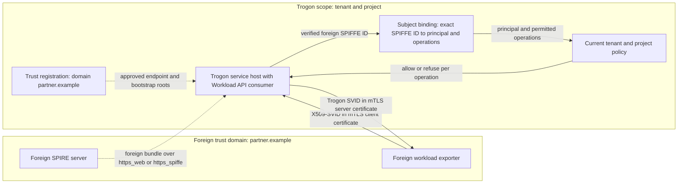
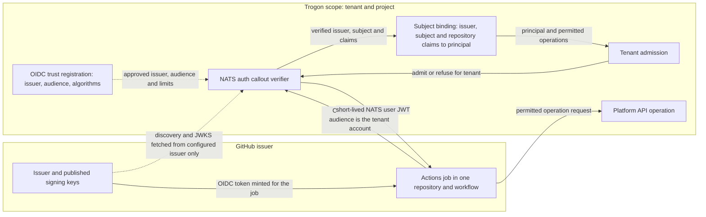
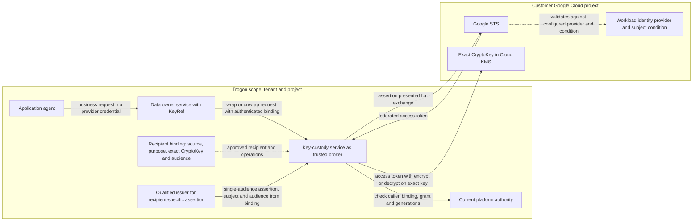

# Federation use-case and trust-profile inventory

Status: source-backed design proposal for review. This document does not change an accepted
ADR or establish implemented provider support. It is the F01 proposal from the
[federation proposal](./federation.md#implementation-sequence-and-proof-gates), not the
reviewed exit of that step.

Source baseline: repository `main` at
[`ba2654e`](https://github.com/TrogonStack/trogonai/tree/ba2654ed0c8bda041793f8bbac4f190c22e54440),
reviewed on 2026-11-15. The configuration contracts described below are the design
protobufs mapped in the [configuration contract
reference](../../reference/workload-identity-configuration.md). The examples use
illustrative names such as `partner.example`; no real tenant, repository or cloud account is
implied.

## Purpose and scope

F01 asks for the first native foreign-domain, inbound CI and outbound resource examples to
be bound to exact owners, subjects, scopes, recipients and deployment capabilities, with
provider access attributed to either the platform service or an agent. Each example below
fixes one direction and answers the same questions in the same order, using the concepts
from [Trust and authority model](./federation.md#trust-and-authority-model).

The examples:

- **Native SPIFFE:** a peer in a foreign SPIFFE trust domain presents its X.509-SVID to a
  Trogon service.
- **Inbound CI:** a GitHub Actions job presents its OIDC token to Trogon.
- **Outbound resource:** the platform key-custody service uses a recipient-specific
  assertion to reach a customer-owned Google Cloud KMS key.

### Status labels

Every field in the binding tables carries one label:

| Label | Meaning |
| --- | --- |
| Exists | Implemented behavior or type on `main`, with the cited path. |
| Schema | Design protobuf on `main` under `proto/trogonai/platform/workload_federation/v1alpha1/` with no runtime service. For support purposes this is proposed. |
| Proposed | Not on `main`. The cited F-step or ADR work would add it. |

Only Exists establishes behavior. Schema presence does not establish an owner service,
admission, or interoperability, as the contract reference states.

### Reading the diagrams

Each diagram is a Mermaid flowchart, matching the existing workload identity documents.
An edge label names the credential or request and the arrow points from the party that
presents it to the party that receives it. Dashed edges are configuration or trust
distribution, not request flow. A solid edge never carries authority across a boundary
unless its label names the credential that does so.

## Native SPIFFE: foreign peer calls a Trogon service

### Why this example

The consumer on `main` already parses `federated_bundles` from the Workload API response
and refuses a bundle that overlaps the local domain
(`rsworkspace/crates/platform/trogon-workload-identity/src/workload_context.rs`). A test
shows that a foreign root is present but not trusted implicitly
(`tests/bundle_snapshot_tests.rs`, `multiple_identities_share_an_equivalent_bundle_without_implicit_foreign_trust`).
The server-side verifier and peer evidence path (`RegisteredClientVerifier`,
`PeerEvidence`, `PeerIdentity::from_workload_certificates` in `trogon-egress-proxy`) is
the only SPIFFE mTLS acceptance path in the repository. That makes "foreign peer calls
Trogon" the direction where a verifier, evidence type and audit shape already exist and
only the foreign trust source and subject mapping are missing.

The reverse direction, a Trogon workload calling a foreign service, needs the same bundle
relationship held by the other party plus Trogon's expected-peer client verification
(`tls::client_config`). It is a separate relationship; one direction does not imply the
other.

### What main refuses today

These refusals are deliberate and define the gap:

- Candidate verification roots come from the bundle of the local identity's trust domain
  only (`candidate.rs`, `bundle_set().get(expected.trust_domain())`). Federated bundles are
  parsed and bounded but never used for chain verification.
- Registration is rejected when a binding's trust domain differs from the local domain
  (`identity_store.rs`; `trogon-egress-proxy/src/workload_registration.rs`,
  `RegistrationProjectionError::Scope`).
- The client-certificate verifier accepts only an exact registered SPIFFE ID whose binding
  has an application identity (`tls.rs`, `RegisteredClientVerifier`).
- The registered role set is `EGRESS_PROXY`, `AGENT` and `SUPERVISOR`
  (`workload_role.proto`), and `RegistrationBinding` requires an `application_id` exactly
  when the role is `AGENT`.

So a foreign workload cannot be admitted by loosening a check. It needs a distinct
relationship and mapping, which is what the federation contracts propose.

### Binding

| Question | Answer | Status |
| --- | --- | --- |
| Trust relationship owner | The tenant or project administrator for the `WorkloadScope` that holds the `TrustRegistration`. Trogon does not become a registrar for the foreign domain; the foreign domain's administrator separately owns what Trogon may present to it. | Schema: `TrustRegistrationDefinition.scope`, `TrustRegistrationRef`. Owner service Proposed (F02). |
| Trust relationship content | Exact `SpiffeTrustDomain` (for example `partner.example`), one endpoint profile (`https_web` or `https_spiffe` with `expected_spiffe_id` and bootstrap roots), `TrustRefreshPolicy` (refresh interval, maximum staleness, rotation overlap, between three and five refresh intervals) and a required `owner` principal. | Schema: `SpiffeTrustProfile` in `trust_registration.proto`. Runtime Proposed (F02). |
| Foreign bundle source | The authenticated bundle endpoint of the foreign domain, retained per domain and never pooled. | Bundle parsing and ambiguity refusal Exists (`workload_context.rs`). Bundle distribution and refresh Proposed (F02, reuse SPIRE federation). |
| External subject form | The full SPIFFE ID with its domain, for example `spiffe://partner.example/ns/exports/sa/exporter` in the partner's own convention, compared exactly. The domain is part of the identity; the path never chooses tenant, project, role or `AgentId`. | Schema: `SpiffeSubjectRequirement` (CEL ties `spiffe_id` to its declared `trust_domain`). |
| Platform binding | `SubjectBindingDefinition` with `scope`, `principal_id` (an existing platform principal), `permitted_operation_ids`, `max_session_lifetime` and `reusable_within_original_validity` replay mode. No `AgentId`: a foreign workload is a principal, not an application agent, unless review decides otherwise (see open questions). | Schema: `subject_binding.proto`. Principal type `PrincipalId` Exists as schema in `connections/types/v1alpha1/identity.proto`. Runtime Proposed (F02, F03). |
| Operation grant and scope | A finite list of `PlatformOperationId` values the foreign principal may perform, intersected with current tenant/project policy at the time of use. The operation catalogue that resolves these identifiers is not defined on `main`. | Schema for the field. Catalogue and enforcement Proposed (F02, F03). |
| Recipient binding | The Trogon service that terminates the mTLS connection. Its own SVID, local trust domain and server identity are what the foreign peer verifies; there is no cloud recipient. | Local server material Exists (`MaterialLease::server_config`). Foreign peer's expected-server configuration lives with the foreign domain. |
| Credential at the external boundary | X.509-SVID of the foreign workload, presented in the TLS client certificate, chained to a root in the foreign bundle for that exact domain. | Format Exists (SPIFFE). Foreign-root verification Proposed (F02, F03). |
| Credential at the platform boundary | Verified `PeerEvidence` and a `WorkloadPeerEvidence` audit record (leaf SHA-256, path expiry, registration, trust and activation revisions, bundle digest). A foreign variant also needs the foreign domain and bundle generation. | Local-domain evidence Exists (`peer_evidence.rs`, `trogon-egress-proxy/src/peer_identity.rs`). Foreign variant Proposed (F02). |
| Execution holder | The trusted Trogon service holding its own SVID and `MaterialLease`. The foreign peer holds its own private key; Trogon never sees it. | Exists for the local side (`trogon-workload-identity`). |
| Deployment capabilities | SPIRE federation configured on both sides (`federates_with` on the SPIRE servers; the SPIRE Agent exposes the foreign bundle through the Workload API), a bundle endpoint reachable under the selected profile, the Unix Workload API socket on the Trogon host, independent recovery fence and approved-root governance for the foreign domain, and audit admission. | Local pieces Exist (`docs/reference/workload-identity.md`). Federation deployment Proposed (F02, F03). |
| Who requests provider access | Not applicable. No cloud credential is involved. The foreign peer is an authenticated caller, not an agent acting for Trogon. | n/a |

### Trust diagram

Direction: the foreign workload presents an X.509-SVID to the Trogon service host. The
Trogon service host presents its own SVID back so the foreign peer can authenticate it
under the relationship the foreign domain holds. The binding and policy checks run only
after the foreign chain verifies against the exact foreign bundle.

### Negative cases this example must fail

From the [required negative acceptance
cases](./federation.md#required-negative-acceptance-cases): a foreign issuer signing a
different domain, pooled roots, a valid foreign SVID with no binding, wrong tenant,
project or role, a foreign URI path interpreted as local privilege, and a removed or
restored bundle. The F03 vertical proof is the exit for these.

## Inbound CI: GitHub Actions workload enters Trogon

### Why this example

The NATS authentication callout in `rsworkspace/crates/a2a/a2a-auth-callout` already
verifies an administrator-configured OIDC issuer: discovery with issuer match, same-origin
JWKS, disabled redirects, an RSA allowlist, exact issuer and audience, `kid` lookup and
rejection of `crit` headers (`credentials/oidc.rs`). GitHub Actions signs with RS256, so
the algorithm profile is compatible. Admission to a tenant is a separate step
(`tenant_admission.rs`, `tenant_membership.rs`, `AUTH_CALLOUT_TENANT_MEMBERSHIPS`), and the
caller identity is namespaced by issuer (`CallerNamespace::Oidc { issuer }`,
`derive_caller_id`), which is the property the trust model requires.

### What main does not do

- It configures one issuer through `AUTH_CALLOUT_OIDC_ISSUER` and
  `AUTH_CALLOUT_OIDC_AUDIENCES`. It verifies `iss`, `aud`, `exp`, `nbf` and `sub` and
  derives the caller from `sub`. It does not evaluate GitHub-specific claims such as
  repository and owner identity, workflow reference, event, ref, environment or reusable
  workflow digest.
- It performs no per-subject binding to operations. Permissions are issued by the callout
  under the tenant account (`permissions`, `IssuedPermissions`), not from a governed
  subject binding.
- It has no replay admission and no GitHub subject-format handling.
- Its discovery document is fetched once at startup; there is no governed refresh or
  withdrawal state.

### Binding

| Question | Answer | Status |
| --- | --- | --- |
| Trust relationship owner | The tenant administrator for the `WorkloadScope` that holds the OIDC `TrustRegistration`. GitHub owns the issuer and its signing keys; the repository or organization owner owns the workflow and its protections. | Schema: `OidcTrustProfile`, `TrustRegistrationDefinition.scope`. Today the issuer is deployment configuration of the callout (`AUTH_CALLOUT_OIDC_ISSUER`, Exists). Owner service Proposed (F09). |
| Trust relationship content | Issuer `https://token.actions.githubusercontent.com` (or the issuer variant for the actual GitHub deployment), expected audience, discovery or pinned JWKS, allowed algorithms, maximum token lifetime, clock skew, byte and key bounds. | Schema: `OidcTrustProfile`, `OidcVerificationPolicy`. Issuer, audiences, RSA allowlist and discovery limits Exist in `credentials/oidc.rs` and `main.rs`. |
| External subject form | The pair of issuer and `sub`, never `sub` alone. The `sub` format is a property of the repository's GitHub configuration: the older name-based form, the ID-based immutable form, or a custom template. The profile records which, and binds immutable repository and owner IDs so a rename or transfer cannot inherit authority. | Schema: `OidcSubjectRequirement.subject`, `GithubActionsSubjectRequirement` (`repository_id`, `repository_owner_id`, `subject_format`, `workflow_ref`, `allowed_events`, `ref`, `environment`, `reusable_workflow`, `allow_fork_origin`). Issuer-namespaced caller identity Exists (`CallerNamespace::Oidc`). GitHub claim evaluation Proposed (F09). |
| Platform binding | `SubjectBindingDefinition` mapping that exact subject to a `principal_id` in the tenant and project scope. The token never supplies tenant, role or `AgentId`. | Schema: `subject_binding.proto`. Tenant membership by `(tenant, issuer, sub)` Exists (`TenantMembership::for_oidc_subject`). Governed binding Proposed (F09). |
| Operation grant and scope | A finite `permitted_operation_ids` list and a `max_session_lifetime`. The first platform operation for CI should be one narrowly named API operation, not a general NATS user. | Schema for the fields. Callout NATS permission issuance Exists but is not driven by this binding. Operation catalogue Proposed (F09). |
| Recipient binding | The Trogon tenant account named by the token audience. `TenantMembership::from_verified_credential` refuses an audience that differs from the tenant account. | Exists (`tenant_membership.rs`). |
| Credential at the external boundary | GitHub OIDC JWT, an RS256 bearer token. It is not proof of possession of any key. | Exists (verification). Holder-binding Proposed only if a later profile needs one. |
| Credential at the platform boundary | A short-lived NATS user JWT signed for the tenant account, default 300 seconds (`DEFAULT_USER_JWT_TTL_SECS`), with the source token's expiry retained as ephemeral evidence (`VerifiedCredential`, `CredentialExpiry`). A governed session must additionally cite the original source expiry and authority revision. | NATS user JWT Exists (`jwt/nats_user_jwt.rs`). Evidence record `InboundAdmissionEvidence` Schema (`inbound_admission.proto`). |
| Execution holder | At Trogon, the authentication callout service holding signing keys and the tenant admission data. At GitHub, the running job holds the OIDC token. No local SVID is minted. | Callout Exists. No-automatic-enrollment rule is a design constraint from the federation proposal. |
| Deployment capabilities | Callout reachable by the NATS server, outbound HTTPS to the issuer for discovery and JWKS under an egress permit, tenant membership data, tenant signing keys through the configured source, audit admission, and an issuer-to-tenant mapping owned by the platform. Repository settings on the GitHub side: OIDC token permission in the workflow, and the subject template that the profile records. | Callout deployment Exists. Governed issuer and mapping Proposed (F09). GitHub-side settings are upstream configuration. |
| Who requests provider access | No Trogon-side provider access. The CI job is an external workload calling Trogon; it is neither the platform service nor a Trogon agent and must not be given an `AgentId`. | n/a |

### Trust diagram

Direction: GitHub issues a token to the job. The job presents it to the Trogon callout.
Trogon never presents a credential to GitHub in this example, and the callout fetches
discovery and keys only from the administrator-configured issuer, never from a URL the
token names. The platform credential given back to the job is a separate, shorter-lived
credential with its own scope.

### Negative cases this example must fail

Name-only takeover after a repository rename or transfer, wrong subject template, fork
pull request, wrong event or environment, wrong or unapproved reusable-workflow digest,
missing required job claims, wrong audience, expired token and issuer-key rotation, as
listed in the [GitHub negative cases](./federation.md#required-negative-acceptance-cases).
F09 is the exit; the existing callout verifier tests cover only the generic issuer and
audience properties.

## Outbound resource: key-custody service reaches customer Google Cloud KMS

### Why this example

[ADR#0030](../../adr/0030-customer-controlled-key-backend-routing.md) already specifies
that Google Cloud KMS access uses Workload Identity Federation for direct access to the
exact CryptoKey, binding issuer, audience, subject, attribute mapping and attribute
conditions, with service-account impersonation as an allowed fallback and no
service-account key stored. Of the provider candidates, this is the one with the most
existing contract text:

- `GoogleCloudKmsAccess`, `GoogleCloudFederationAuthentication` and
  `GoogleCloudKmsKeyLocator` (exact `GoogleCloudKmsCryptoKeyName`, never a
  `CryptoKeyVersion`) exist as schema in `proto/trogonai/platform/key_custody/v1alpha1/`.
- `GoogleCloudOidcRecipient` and `RecipientBindingDefinition` exist as schema in
  `proto/trogonai/platform/workload_federation/v1alpha1/`, with
  `direct_resource_access` and `impersonated_service_account` as distinct access modes.
- The wrapping ports `WrapDek` and `UnwrapDek` exist in
  `rsworkspace/crates/platform/trogon-key-management`, and the sealed-envelope owner is
  accepted [ADR#0083](../../adr/0083-sealed-content-envelope.md).

The AWS KMS profile in the same ADR uses STS `AssumeRole` with an ExternalId, which the
[federation proposal](./federation.md#provider-adapter-choices) keeps distinct from
web-identity federation. Choosing Google Cloud keeps this example about federation rather
than about that other profile. An AWS KMS example can follow once reviewers decide the
profile; see the open questions.

The egress proxy is deliberately not the example. It authenticates an agent and forwards a
destination under an exact permit; it holds no provider credential and exchanges none.

### What main does not do

- No Google Cloud KMS client, JWT-SVID acquisition, token exchange, broker or
  federation exchange service exists on `main`; the only Rust KMS-shaped code is the
  portable wrapping port and its test support.
- The registered workload role set has no custody-service role, and
  `RecipientBindingDefinition.source.local_workload` reuses the local `RegistrationBinding`.
  A custody service therefore has no registrable local identity to bind as the source yet.
- [ADR#0074](../../adr/0074-credential-platform-extraction-boundary.md) still requires
  extracting the gateway's provider client into the secrets owner before a custody
  service owns provider access.

### Binding

| Question | Answer | Status |
| --- | --- | --- |
| Trust relationship owner | Two owners, kept separate. The customer's Google Cloud administrator owns the workload identity pool, provider, subject mapping, attribute condition and KMS IAM grant on their own project; this is what lets the customer shut access off. The Trogon tenant administrator owns the Trogon-side key backend registration and `RecipientBinding`. | Customer side is upstream configuration ([ADR#0030](../../adr/0030-customer-controlled-key-backend-routing.md) Decision 5). Trogon side Schema: `RecipientBindingDefinition.scope`, `KeyBackendAccess.google_cloud_kms`. Owner service Proposed (F05, F07). |
| External subject form | The assertion subject Trogon presents to Google: the exact `sub` of the recipient-specific JWT-SVID or issuer assertion, for example the custody service's SPIFFE ID in the Trogon trust domain. Mapped by the customer to `google.subject`; no wildcard. | Schema: `GoogleCloudOidcRecipient.assertion_subject` (pattern forbids `*`). JWT-SVID or issuer acquisition Proposed (F04). |
| Platform binding | `RecipientBindingDefinition.source` names the allowed source identity and `purpose_id` names the purpose, within one tenant and project scope. The data owner's `KeyRef` and `KeyBackendRegistration` determine which key; the caller cannot select backend, role or account. | Schema: `source_identity.proto`, `recipient_binding.proto`, `key_custody/v1alpha1/binding.proto`. Source identity as a custody-service role Proposed (F05). |
| Operation grant and scope | `RecipientOperation` with an `operation_id` from the adapter's catalogue (wrap and unwrap of a DEK), `resource_ids` containing the exact CryptoKey name, and `scopes` empty or exact. The executor, not the caller, derives the provider request. | Schema: `RecipientOperation`. Adapter operation catalogue Proposed (F05, F07). Domain operations `WrapDek` and `UnwrapDek` Exist. |
| Recipient binding | `provider_resource` (the workload identity provider), `assertion_audience`, `access` (direct resource access for the baseline, optional impersonated service account) and the exact key name from the key locator. Endpoints are derived from the verified provider resource and cannot be overridden by tenant data. | Schema: `GoogleCloudOidcRecipient`, `GoogleCloudAccessMode`, `GoogleCloudKmsKeyLocator`. Provider qualification Proposed (F07). |
| Credential at each boundary | Boundary one, Trogon authority to assertion: current attested material and registration. Boundary two, assertion to Google STS: a single-audience, short-lived JWT-SVID or issuer assertion. Boundary three, STS to KMS: a Google federated or impersonated access token. Each is distinct and none is reused for another recipient. | Local material Exists. Assertion Proposed (F04). Exchange Proposed (F05, F07). |
| Execution holder | The key-custody service acting as the trusted broker, with `FEDERATION_CREDENTIAL_DELIVERY_BROKER_HELD`. The assertion and the Google token never reach an agent, a prompt, a durable event or a log. | Delivery enum Schema (`recipient_binding.proto`). Broker and custody service Proposed (F05, [ADR#0074](../../adr/0074-credential-platform-extraction-boundary.md)). |
| Deployment capabilities | A qualified issuer producing the assertion with a discovery origin Google can reach, a customer pool and provider whose condition accepts only the exact subject, a KMS IAM grant limited to one CryptoKey and the cryptographic actions, egress permits for the Google STS and KMS hosts, a use guard that rechecks authority after exchange, and a customer shutdown procedure. | Egress exact-destination permits Exist (`trogon-egress-proxy`). Issuer, broker and guard Proposed (F04, F05). Customer IAM is upstream. |
| Who requests provider access | The platform service. The key-custody service requests the Google credential when it performs a wrap or unwrap that a data owner already authorized. An agent requests a business operation (for example saving or reading a protected value) and never asks for, names or receives provider access, role or audience. | Design constraint; see [Trogon workloads accessing external resources](./federation.md#trogon-workloads-accessing-external-resources). |

### Trust diagram

Direction: the agent only ever presents a business request to the data owner. The
key-custody service obtains the assertion from the qualified issuer, presents it to Google
STS, receives a Google token and presents that token to Cloud KMS. The customer's pool
condition and IAM grant are the customer's independent kill switch. Trogon revokes by
refusing further broker use; it cannot erase a token Google has issued before that token's
own expiry, as the [lifetimes section](./federation.md#lifetimes-caching-and-revocation)
describes.

### Negative cases this example must fail

Caller-selected account, key, audience or STS endpoint, a wrong recipient, one provider's
token reused at another, an assertion minted after original authority expired, a guest or
agent receiving a token, a broad pool grant, a service-account key, and a provider denial
retried under another identity, per the outbound and provider rows of the [negative
cases](./federation.md#required-negative-acceptance-cases). F05 and F07 are the exit.

## Requested by the platform service or by an agent

| Example | Provider access requested by | Reason |
| --- | --- | --- |
| Native SPIFFE foreign peer | None | Authentication only. The foreign workload is a caller, mapped to a principal; it is not a Trogon agent and receives no provider credential. |
| GitHub Actions inbound | None on the Trogon side | The CI job is an external caller. It receives a short-lived Trogon credential for a bounded operation and never an `AgentId`. |
| Google Cloud KMS outbound | Platform service (key-custody broker) | Provider identity, audience and key are fixed by governed configuration. An agent can cause a wrap or unwrap only by asking the data owner, which keeps provider locators and credentials out of agent and decider code. |

An agent never requests a cloud role, client, STS endpoint or token in any example. If a
future use case needs an agent-initiated provider call, it is a different delivery profile
that [ADR#0053](../../adr/0053-external-oidc-federation-surface.md) treats as separately
reviewed, not an implicit variation of these.

## Open questions for review

Items only a human reviewer can decide:

1. **Foreign principal type.** Should a foreign SPIFFE peer map to a plain `PrincipalId`
   with no `AgentId`, or must some foreign workloads be admitted as application agents?
   The local `RegistrationBinding` ties `AgentId` to the `AGENT` role, and the federation
   proposal says an inbound subject does not enroll a local workload.
2. **Native service host.** Which Trogon service terminates foreign-domain mTLS first?
   Only the egress proxy listener hosts the SPIFFE verifier today, and it authorizes
   destinations, not service operations. Using it for foreign callers may be the wrong
   service.
3. **Operation catalogue.** Where is the catalogue that resolves `PlatformOperationId` and
   `RecipientOperationId` owned, and what is the first inbound CI operation? The schemas
   reference identifiers but no catalogue exists on `main`.
4. **GitHub issuer variants.** Is the first profile limited to GitHub.com, or must GitHub
   Enterprise Server issuers be in scope? Both the subject format and the issuer
   discovery origin differ.
5. **Callout versus new edge.** Should the inbound CI profile extend the NATS
   authentication callout, whose single configured issuer and generic claim handling are
   shaped for NATS admission, or run behind a separate edge with governed trust
   registrations? This affects who owns the trust registration at runtime.
6. **Outbound provider for the first example.** Is Google Cloud KMS the right first
   outbound example, or does AWS KMS need priority given that
   [ADR#0030](../../adr/0030-customer-controlled-key-backend-routing.md) specifies
   `AssumeRole` with ExternalId rather than web-identity federation for AWS? If AWS is
   first, should web identity replace that profile or sit beside it?
7. **Custody-service identity.** How is the key-custody service registered as a source
   identity, given that the registered role set has no such role and the key-custody
   extraction in [ADR#0074](../../adr/0074-credential-platform-extraction-boundary.md) is
   not complete? Is a new role, or a distinct source type, preferred?
8. **Assertion issuer for the outbound example.** The proposal prefers native JWT-SVID
   issuance with the SPIRE discovery helper pending F04. Reviewers should confirm that
   F01 may assume that outcome for the diagram, with the separate assertion issuer as the
   documented alternative.
9. **Residual window acceptance.** For Google, is the provider token lifetime window
   after local withdrawal acceptable for key wrapping, or does the customer shutdown
   procedure need an additional guarantee before the example is claimed?
10. **Reverse native direction.** Is Trogon-to-foreign-service in scope for the first
    release, given that it needs the counterpart relationship held by the other party?

## Exit criteria status

The F01 exit is "reviewed trust diagrams and no ambiguous direction". This document
supplies the diagrams, the bindings and the direction statements for review. It is not the
exit. The exit is met only when a human reviewer has examined each diagram, resolved or
explicitly deferred the open questions above, and recorded that review.

What this document establishes, subject to that review:

- Each example has one stated direction, one presenting party per edge, and a named owner
  for each trust relationship.
- Each field is labeled Exists, Schema or Proposed with a cited source.
- Provider access is attributed to the platform service or marked not applicable.

What it does not establish: any implemented federation support, any executed provider or
transport acceptance, or any accepted ADR decision. Those belong to F02 through F10 and to
the [ADR process](../../adr/0000-adr-process.md).
