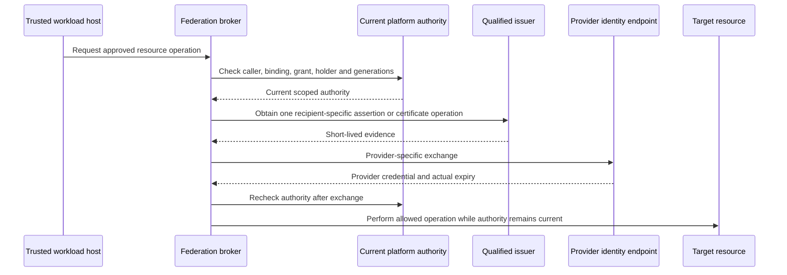

# Workload identity federation proposal

Status: source-backed design proposal. This document does not change an accepted ADR or
establish implemented provider support. Validate these choices through ADR review and real
conformance before advertising support.

Source baseline: repository `main` at
[`8d541e6`](https://github.com/TrogonStack/trogonai/tree/8d541e6a868e9016405b3846db56bb5b983243a0),
reviewed on 2026-11-09. Provider documentation was reviewed on the same date; those pages
can change. This proposal specializes the [portable identity and adapter
roadmap](./adapter-roadmap.md). Design work identifiers are planning references, not
assigned ADR numbers or approved wire types.

For terminology and the implemented foundation, read the [workload identity
explanation](../../architecture/workload-identity.md) and [runtime acceptance
reference](../../reference/workload-identity.md).

## Recommendation

Build federation as explicit relationships around Trogon's governed authority. Keep SPIFFE
as the proposed portable workload-identity foundation. Reuse SPIRE's bundle federation and
OIDC discovery helper where they meet our contracts. Add provider-specific credential
adapters only at the boundary that actually needs them.

Support must be named by direction and profile:

- **SPIFFE domain to SPIFFE domain:** distribute authenticated foreign bundles, then
  authorize exact foreign identities locally.
- **External workload to Trogon:** verify a configured external credential and map its
  subject to limited platform authority. This does not automatically enroll a local SPIFFE
  workload.
- **Trogon workload to external resource:** use an explicitly registered recipient
  relationship to obtain and use external credentials under live platform policy.

Neither AWS nor GitHub nor Kubernetes is needed for the native SPIFFE path. A provider
adapter can be installed without changing application identity, tenant ownership, business
key references or the meaning of authorization.

## Established facts and gaps

| Boundary | Evidence and implication |
| --- | --- |
| Local X.509 workload identity | Main has the Unix Workload API consumer, exact registration, root fingerprint approval, activation audit and finite leases. Reuse this material and currentness owner. |
| Foreign bundles | Main parses federated bundle fields and tests ambiguity/local-override refusal. Their presence does not establish a managed cross-domain trust relationship or automatic authorization of foreign peers. |
| JWT-SVID acquisition | No JWT-SVID acquisition/issuance integration was found in Trogon's workload consumer. Its X.509 path is not a JWT exchange adapter. |
| Existing OIDC verification | The NATS callout verifies a configured OIDC issuer and expected audiences, with a specific RSA verifier profile and separate tenant membership admission. This is reusable bounded verification behavior, not a complete GitHub workflow-claim admission policy. |
| External assertion issuer | [ADR#0053](../../adr/0053-external-oidc-federation-surface.md) is draft. It requires a separate external OIDC surface rather than treating AAuth well-known keys as OIDC discovery. No general external resource federation implementation follows from the ADR. |
| SPIRE support | The already pinned SPIRE source has native federation configuration, JWT issuer/key-type settings, JWT-SVID TTL settings, and an OIDC discovery provider under `support/oidc-discovery-provider/`. Evaluate these before writing an equivalent discovery service. |
| SPIRE OIDC helper | It publishes `/.well-known/openid-configuration` and `/keys`, plus optional health endpoints. It publishes public verification material; it is not a Trogon policy engine, user-consent service or token-exchange broker. |
| AWS OIDC | IAM discovery/JWKS and `AssumeRoleWithWebIdentity` are supported provider mechanisms. The API returns AWS signing credentials and has a 900-second minimum session, normally defaulting to 3600 seconds. It is not the RFC 8693 token endpoint. |
| AWS certificate path | IAM Roles Anywhere accepts credentials rooted in an explicitly registered X.509 trust anchor and returns temporary role credentials. SPIFFE SVID algorithm/profile and exact subject admission must be qualified; CA trust alone is too broad. |
| GCP OIDC | WIF has explicit issuer/JWKS, subject mapping, audience and attribute conditions; direct resource access and service-account impersonation are distinct choices. |
| GCP certificate path | Current official documentation describes X.509 WIF using an mTLS STS endpoint, and shows an exact `assertion.san.uri` SPIFFE-ID condition. Evaluate compatibility rather than assuming OIDC is mandatory. |
| GCP token binding | Certificate-bound OIDC tokens are documented as Preview. Initial certificate authentication or a confirmation claim alone does not prove every target API enforces the binding. Keep this optional until the complete resource path is tested. |
| Entra | Current documentation supports RS256 external assertions, exact issuer/subject/single-audience binding and no wildcards in the reviewed federated identity credential properties. Its consistency and quota limits are operational inputs. |
| GitHub | Issuer/audience/subject and additional workflow/repository claims are available. Current docs describe immutable default subjects for repositories created after 2026-07-15 and opt-in/migration behavior for older repositories. GitHub Enterprise Server differs. Do not hardcode the old name-only subject format. |

These are documentation and source observations, not executed provider acceptance.
SPIFFE/SPIRE primary specifications and implementation documentation are linked in [Sources
and evidence limits](#sources-and-evidence-limits).

## Trust and authority model

Keep the following concepts separate in types, persistence, authorization and audit:

| Concept | Meaning |
| --- | --- |
| Trust relationship | Which external issuer/domain, endpoint, verification keys and protocol profile an administrator has approved. |
| External subject | A name inside that specific issuer/domain. Never identify it by a bare subject string alone. |
| Platform binding | Which tenant/project, role and, where applicable, application AgentId that verified external subject may represent. |
| Operation grant | Which exact operation, destination/resource and purpose it may perform now. |
| Recipient binding | Which exact cloud account/project/directory, role/client/resource and audience accepts our credential. |
| Credential | Evidence used at one authentication/exchange boundary. It does not carry unreviewed authority into another boundary. |
| Execution holder | The trusted process allowed to possess/use a credential and the current local authority it must retain. |

A verified foreign SPIFFE ID remains foreign. Do not silently rewrite its domain into ours
or infer tenant identity from its URI path. An OIDC token with a valid signature remains a
credential from its configured issuer. It does not authorize enrollment as an arbitrary
local workload or establish person delegation.

Every relationship is explicit, owned, revisioned, auditable and revocable. Use the existing
tenant/project hierarchy and policy owners. Administrative access to add/change a trust
relationship is distinct from permission to use it. Widening subjects, adding issuers or
replacing trust roots requires the appropriate independent approval; emergency denial must
not wait for a grant review.

## Native SPIFFE trust-domain federation

Configure each direction explicitly. If Trogon authenticates a customer workload, Trogon
needs that customer's bundle relationship. If the customer authenticates Trogon, the
customer needs a corresponding relationship. One direction does not imply the other, and
neither implies trust in a third domain that the peer happens to trust.

Each relationship retains at least:

- The exact foreign trust-domain name.
- The approved bundle endpoint URL and explicit endpoint profile.
- For `https_spiffe`, the expected endpoint SPIFFE ID and independently authenticated
  bootstrap bundle.
- The owner, lifecycle/admission policy, accepted configuration revision, restore fence and
  validity/staleness policy required by our deployment contract.
- The authorized foreign subjects or admitted subject classes and their explicit platform
  mappings.

The SPIFFE specification requires preserving the `<trust domain,bundle>` association. Never
concatenate all foreign roots into one general trust store. Doing that lets an authority for
one domain authenticate an identity claiming another domain. Domain association cannot be
inferred from an endpoint's DNS hostname; a trust domain need not even be a registered DNS
name.

Use the specified `https_web` or `https_spiffe` profile with no automatic
downgrade/fallback. SPIRE already implements these profiles. Federation clients must satisfy
the supported SPIFFE profiles; a particular deployment may deliberately configure only the
selected relationships. Treat endpoint changes as governed trust changes. Specify redirect
behavior explicitly; the SPIFFE specification permits operational redirects with security
cautions, so a stricter no-redirect deployment policy must be documented as that policy
rather than attributed to the standard.

Keep imported public bundles distinct from admitted platform authority. Authentication
proceeds with the exact domain bundle and full certificate/SVID validation, then Trogon
applies its registration and operation policy. Foreign root distribution alone cannot create
tenant membership, a destination permit or a Connection grant.

Define bundle refresh, overlap, failure, explicit removal and compromise behavior. A
stale-cache policy needs a Trogon contract and measurements; it cannot be inferred from HTTP
cache hints. Explicit withdrawal must invalidate the local binding and captured sessions
according to the selected profile. Rotation and independently fenced restore must not
reintroduce an earlier revoked bundle or relationship.

## External workloads entering Trogon

The initial inbound CI profile should authorize limited platform API operations, not
automatically mint a local SVID for every verified external token. Local enrollment remains
a separate attestation and holder-key flow through the qualified issuer.

The inbound edge must:

1. Select an administrator-configured issuer/profile independently of untrusted token URLs.
   Never fetch discovery or keys merely because a token names them.
2. Verify the token under the profile's algorithm/key policy, exact issuer and audience,
   validity and required claims. Apply bounded authenticated discovery/JWKS retrieval,
   rotation, response limits and explicit error categories.
3. Preserve the issuer namespace and verified external claims. Do not trust a
   caller-supplied tenant, AgentId, role or SPIFFE URI as the mapping.
4. Resolve the governed binding to the permitted platform principal and operations, then
   recheck current admission.
5. Bind any internal session/credential to the approved original source, bounded lifetime,
   holder and authority revision. Raw bearer-token acceptance must not be described as
   source-key possession.
6. Record metadata-only admission/use evidence and refuse unsupported or ambiguous profiles.

For GitHub Actions, the relationship must address issuer variant, immutable repository and
owner identity, actual configured subject template, workflow/ref/environment and
reusable-workflow constraints. Verify relevant `job_workflow_ref`/`job_workflow_sha` claims
only when that profile requires a reusable workflow. Claims absent in another legitimate
flow cannot be treated as implicitly satisfied.

Test repository rename/transfer, old and immutable subject formats, wrong owner/repository,
fork PR, wrong event/environment/ref/audience, unapproved workflow changes, expired token
and issuer-key rotation. Protected branches/environments are upstream governance
dependencies, not cryptographic proof that every job's code is trusted. Define the exact
accepted events and permissions.

If one-time platform redemption is required, specify atomic replay admission and
lost-ack/idempotency behavior. A GitHub `jti` is useful evidence, but generic OIDC does not
require every issuer to supply the same replay identifier. Missing/changed identifiers
require a profile decision, not an invented token field. Do not make persistent stores or
logs retain the raw assertion.

Kubernetes and other external OIDC issuers are separate profiles. A Kubernetes
service-account JWT proves its selected claims under cluster trust; it does not by itself
prove all the node/process isolation properties of the local SPIFFE workload profile. Choose
offline JWT versus API-server token-review behavior and bound-object revocation explicitly
if such a profile is selected.

## Trogon workloads accessing external resources

The trusted host obtains current attested material and platform authority, resolves an exact
configured recipient binding and requests the adapter operation. The workload cannot select
an arbitrary role, client ID, STS URL, key, audience, scope set or provider account.

The broker is a proposed responsibility, not a new approved generic service/API. Place it
with the current custody/executor owners or a separately reviewed control-plane owner. Do
not bypass the platform secrets-service boundary by placing customer-provider clients and
locators in ordinary agent/decider code. Workload access to the privileged Workload API and
signing material remains host-owned.

Check authority before issuance/exchange, after asynchronous exchange, at credential reuse
and immediately before resource use. Retain the original wall/monotonic deadline and
source/binding generations. A newer token cannot refresh an expired original grant.
Cancellation/timeout does not prove that a dispatched provider request was never sent or
never issued a token; preserve possible-effect state and the actual provider's retry
semantics.

Only keep usable provider credentials in the trusted execution/custody boundary. Agent
prompts, tool arguments/results, durable logs/events, and untrusted guests must not receive
assertions, private keys or cloud access keys. If a separate trusted customer process must
receive a credential, define that delivery profile and the authority it can retain outside
Trogon's control explicitly.

### Reuse native JWT-SVID issuance before inventing a duplicate issuer

SPIRE can set `jwt_issuer`, `jwt_key_type` and JWT-SVID TTL. Its OIDC helper can expose
discovery/JWKS at a separate HTTPS origin. This is a credible implementation candidate for
the external surface [ADR#0053](../../adr/0053-external-oidc-federation-surface.md)
requires, distinct from AAuth's well-known documents.

Qualification must prove:

- The issued `sub`, `iss`, single audience and finite TTL match the recipient relationship.
- The selected issuer/key manager actually supports the required algorithm and rotation
  behavior.
- No untrusted process can obtain the same recipient assertion outside the approved
  host/broker path.
- Platform registration, use policy and withdrawal gates still control access; the helper
  itself does not enforce them.
- Discovery's issuer and keys match the actual minted token. Public-key serving over Web PKI
  is not equivalent to exposing the privileged Workload API or signing endpoint.
- Upstream key rotation/publication and recipient JWKS caching cannot strand valid tokens or
  preserve retired authority beyond the approved window.

JWT-SVID is a bearer format unless a separate binding is specified and enforced. It is not
an OIDC interactive user login, and it does not imply a `cnf` claim or proof of the holder's
SVID key. Do not turn its existence into a blanket sender-constraint claim.

If direct native issuance cannot enforce the required platform governance, claim shape,
recipient namespace or isolated key profile, implement the already proposed distinct
federation assertion issuer behind the same governed boundary. Record why native reuse
failed. That is an external assertion issuer, not a new platform certificate authority.

For the Entra profile, current Microsoft documentation confirms supported RS256 assertions.
[ADR#0053](../../adr/0053-external-oidc-federation-surface.md) additionally asserts an
RSA-only published-key-set constraint; that stronger claim was not independently established
by the current page reviewed here. Preserve the conservative existing profile pending direct
primary-source/recipient verification or an explicit ADR revision. Do not silently delete
its requirement or falsely claim the new documentation proves it.

### Provider adapter choices

| Provider profile | Protocol and trust | Design requirement |
| --- | --- | --- |
| AWS OIDC | IAM OIDC provider plus exact `AssumeRoleWithWebIdentity` role trust. Current API supports documented RSA/ECDSA JWT algorithms. | Role/account/audience/subject from governed config; real role/session policy enforcement. Keep this API distinct from STS `AssumeRole` and its [ADR#0030](../../adr/0030-customer-controlled-key-backend-routing.md) ExternalId requirements. |
| AWS X.509 | IAM Roles Anywhere with configured CA trust anchor, role/profile and certificate-holder proof. | Evaluate SVID certificate profile/algorithm, URI subject constraints, CA rotation and provider session duration. Trusting every certificate from a CA would be too broad. |
| GCP OIDC | WIF provider issuer/JWKS, immutable `google.subject` mapping, attribute condition, resource IAM. | Distinguish assertion audience from exchange `audience` provider resource; test direct access versus service-account impersonation as different support profiles. Uploaded JWKS is an explicit alternative with manual rotation/limits, not automatic fallback. |
| GCP X.509 | Registered trust-store anchors, exact certificate attribute mapping/condition, mTLS STS exchange. | Current docs demonstrate `assertion.san.uri` exact SPIFFE-ID conditions. Prove root/URI/holder matching, actual certificate profile, target IAM and rotation before choosing this as a supported path. |
| GCP certificate-bound OIDC | Optional documented Preview profile using `cnf.x5t#S256` and the mTLS STS endpoint. | Require endpoint plus resource enforcement proof and an explicit Preview support policy; do not infer end-to-end binding from exchange success. |
| Entra | Federated identity credential with exact issuer, subject and single audience, followed by the documented client-credential assertion exchange. | Dedicated compatible signing profile; directory/app/managed-identity/resource scope; propagation/quota/unsupported-region handling. A successfully created trust object does not prove a working token exchange. |

Prefer the least additional issuance machinery that preserves the approved authority model
and recipient capability. Direct X.509 candidates may avoid running an internet-accessible
OIDC discovery endpoint for that provider. They do not eliminate provider trust
configuration, independent authorization, key custody or revocation limits.

## Lifetimes, caching and revocation

Treat the following limits independently:

1. Original attested material, governed registration and operation-grant validity.
2. External assertion or exchange certificate validity.
3. Provider-issued credential validity and provider-side enforcement.
4. Trogon-local permitted reuse and physical operation/session lifetime.

For a locally retained resource credential, a reuse deadline is bounded by the earliest
applicable original authority deadline, binding policy and actual provider expiry. Do not
cache merely under subject or audience. Include the issuer/source and trust generations,
registration/binding identity/revision, tenant/project, caller, recipient
provider/account/role/client, exact resource/scope and any holder-binding profile that
materially changes authority. The exact cache key is an implementation contract to review,
not a license to log credentials or expand high-cardinality metrics.

Do not cache exchange assertions for later unrelated operations. Hold only the assertion
needed for an admitted in-progress exchange, then discard it. Provider-specific retry may
obtain a fresh assertion only while original authority remains current; it cannot invent an
unlimited new operation deadline.

AWS's 900-second minimum web-identity session exceeds the existing 330-second registration
ceiling. Requesting a short assertion does not shorten the AWS credential returned.
Consequently:

- An agent receiving raw AWS credentials could retain usable external authority beyond its
  platform lease.
- A trusted per-operation broker can stop Trogon-mediated use after withdrawal by retaining
  the credential and checking current authority.
- A broker cannot retroactively erase an issued credential, undo a dispatched remote effect
  or prevent a credential thief from using it until provider enforcement ends it.

Document this residual window and recipient shutdown procedure. Do not promise
[ADR#0049](../../adr/0049-revocation-latency-target.md)'s five-second in-platform target for
a cloud-issued token. Likewise, deleting an issuer binding or removing a JWK mainly stops
future exchanges after provider caches converge; it is not a guaranteed revocation of
already-issued resource credentials.

Cache failure and explicit withdrawal need different handling. A transient metadata/JWKS
refresh failure can only use previously authenticated state within its explicitly approved
bound; a revoked binding/root must not be treated as a transient outage. Clock rollback must
not extend local authority. Restoring the entire issuer/trust registry requires independent
fence/epoch governance, not a counter restored with the same backup.

## Proposed persistent relationships and responsibilities

The [configuration contract reference](../../reference/workload-identity-configuration.md)
maps the design protobufs for these responsibilities. Schema presence does not
establish a service or execute the admission and interoperability gates below.

- **External trust registration:** protocol/profile, issuer/domain, approved endpoint and
  trust roots/key source, owner, configuration revision, admission state, restore boundary,
  required claims/algorithms and rotation policy.
- **Inbound subject binding:** namespaced verified subject and constraints to an existing
  platform principal/scope, permitted use and finite admission policy. No caller-defined
  tenant mapping.
- **Outbound recipient binding:** allowed source identity/principal and purpose to exact
  external account/project/directory/role/client/resource/audience, algorithm and delivery
  profile.
- **Exchange/use evidence:** metadata for original authority, binding revision, selected
  profile, admitted operation and actual provider result/expiry/correlation. Never raw
  assertions, access/refresh tokens or private key material.
- **Use guard and credential custody:** the owner that keeps the original authority current
  across awaits, reuse and native resource/socket operations. A closure callback with an
  earlier allow result is not sufficient current authority.

Keep operation-specific ports and typed errors. Preserve native SDK evidence through
infrastructure associated types; classify public domain outcomes in the owning
adapter/caller layer, not through message-substring matching. A failure cannot switch
issuer, audience, trust profile, provider role, key or credential source.

## ADR work

Prepare a native SPIFFE federation ADR topic covering relationship ownership, bundle-domain
separation, bootstrap profiles, foreign-subject mapping, withdrawal and restore. Amend
[ADR#0098](../../adr/0098-attested-workload-identity.md) to point to it and distinguish
imported bundle support from operational federation support.

Refine [ADR#0053](../../adr/0053-external-oidc-federation-surface.md) around recipient
profiles and reuse of the existing SPIRE OIDC helper. State the exact issuer/key/claim and
governance conditions required to use native JWT-SVIDs. Keep AAuth identity, inbound
external subject admission, outbound assertions and delegated person authority separate.
Resolve the stronger Entra JWKS claim through a documented evidence task.

Define inbound workload OIDC profiles, starting with GitHub's actual configured claim
format, without changing generic verifier defaults for unrelated issuers. Specify whether an
incoming credential authorizes a platform operation, a finite platform session or a
separately qualified enrollment flow.

Refine [ADR#0049](../../adr/0049-revocation-latency-target.md) references so external
provider validity, source observation, local cache invalidation, native socket closure and
provider token revocation have separate evidence and guarantees. Preserve existing accepted
targets within their actual scope.

Coordinate custody/signing decisions across
[ADR#0023](../../adr/0023-secret-management-and-key-custody-direction.md),
[ADR#0033](../../adr/0033-key-custody-product-model.md),
[ADR#0038](../../adr/0038-agent-identity-crypto-suite.md) and the portable bootstrap/seal
proposal. Do not put issuer/approval bootstrap keys behind a service
they are required to unlock, or turn provider federation into a business envelope-wrapping
capability.

No ADR number is reserved here. [ADR#0000](../../adr/0000-adr-process.md) independent
review/signoff applies before acceptance. Cloud-specific support and Preview features must
be explicit decisions, not consequences of a broad federation label.

## Implementation sequence and proof gates

**F01: Use-case and trust-profile inventory.** Bind the first native foreign-domain, inbound
CI and outbound resource examples to exact owners, subjects, scopes, recipients and
deployment capabilities. Identify which provider access is requested by the platform service
versus an agent. Exit: reviewed trust diagrams and no ambiguous direction.

**F02: Native SPIFFE relationship/control-plane design.** Specify managed
domain/bundle/endpoint mapping, bootstrap and rotation, foreign registration and
nontransitive authorization, independent restore fence and withdrawal propagation. Reuse
SPIRE relationship APIs/configuration. Exit: ADR decision and public contract cases for
wrong-domain CA substitution, endpoint/profile downgrade, local-bundle override and restored
roots.

**F03: Native cross-domain vertical proof.** Run independently controlled local trust
domains without AWS/GitHub/Kubernetes. Prove correct mTLS authentication with explicit
permitted foreign identity and refusal of an authenticated but
unregistered/wrong-tenant/wrong-role peer. Exercise foreign root rotation/removal and
established-session withdrawal. Exit: actual transport/service evidence, not only bundle
parser tests.

**F04: JWT issuance/discovery compatibility spike.** Qualify pinned SPIRE JWT-SVID issuance
plus OIDC helper using the chosen external origin and signing profile. Verify `iss`, exact
`sub`, single `aud`, TTL, algorithm, `kid`, rotation/JWKS overlap and public TLS. Prove
privileged API isolation and current authority before/after issuance. Exit: decide native
reuse versus a separately governed assertion issuer, with a documented reason.

**F05: Trusted exchange/custody and use guard.** Compose current material/registration and
operation-grant owners with proposed recipient bindings, finite broker-held credentials and
exact native adapter requests. Prove cancellation, concurrent revocation/rotation,
post-exchange currentness and no plaintext material escape. Exit: regression evidence that
fails before each behavioral fix and passes afterward, plus actual holder/use evidence.

**F06: AWS proof.** Test exact role/subject/audience/account, wrong-role denial,
web-identity session duration, session-policy limits, cross-account relationship and
provider errors. Treat `AssumeRole`/ExternalId as a different profile when used. Evaluate
Roles Anywhere against the same SVID identity and custody requirements; choose it only after
actual certificate and role-condition proofs. Exit: declared supported protocol and
realistic residual authority.

**F07: GCP proof.** Test exact WIF provider/audience/subject/conditions/resource IAM; direct
resource access and optional impersonation. Compare native X.509 mapping with OIDC using
actual held credentials and root/rotation behavior. Certificate-bound Preview is a separate
gate including actual target resource enforcement. Exit: verified selected path, no
broad-pool grants or service-account keys.

**F08: Entra proof.** Test RS256/exact issuer-subject-audience trust against the selected
app/managed identity and actual resource. Prove wrong binding rejection, supported
region/quota handling, rotation, propagation and provider token lifetime. Close the
RSA-only-JWKS evidence question. Exit: supported profile and exact interoperability limits,
not a successful trust-object create.

**F09: GitHub inbound proof.** Test actual old/immutable/custom subject configuration,
immutable repository identity and required workflow claims; wrong
repo/owner/event/ref/environment, fork and unapproved reusable workflow refusal. Test issuer
rotation, bounded transport parsing and replay/lost acknowledgement rules under the chosen
admission type. Exit: limited real platform operation with no automatic local-SVID
enrollment or untrusted key exposure.

**F10: Operational federation release.** Run all-replica withdrawal,
issuer/JWKS/bundle/provider outage, clock rollback, double writer, restart and independently
fenced restore. Verify metadata-only audit and safe diagnostics, exact SDK/profile support
versions and no default fallback. Exit: support matrix by direction/protocol/recipient and
per-boundary timing/evidence. No mock, schema, compiled adapter or skipped CI gate
substitutes for the missing real profile proof.

Recommended first implementation: F01-F03 for native SPIFFE federation, alongside F04's
bounded issuer compatibility research. This establishes the portable baseline before adding
provider-specific credential paths. Prioritize F06/F07/F08 by actual resource demand; they
are optional adapters. F09 can proceed independently once its admission and custody
contracts are accepted.

## Required negative acceptance cases

| Area | Cases that must fail without new authority |
| --- | --- |
| Bundle trust | Foreign issuer signs a different domain, shared pooled roots, wrong bootstrap ID, caller-chosen endpoint, automatic profile downgrade, stale/restored/explicitly removed bundle. |
| Mapping | Valid credential with no binding; wrong tenant/project/role/AgentId; subject name reused under another issuer; foreign URI path interpreted as local privilege. |
| JWT verification | Wrong issuer/audience/algorithm/key purpose, absent required claim, unsupported encoding, excessive lifetime, expired/not-yet-valid source, malicious discovery/JWKS URL, unbounded parser/key refresh. |
| Outbound selection | Caller-selected role/account/client/audience/STS endpoint/scope; wrong recipient; one provider's token reused at another; assertion minted after original authority expires. |
| Holder and material | Guest receives token/key, bearer token described as PoP, wrong certificate at bound exchange, target API ignoring claimed sender constraint, credential reused after local withdrawal. |
| Races | Registration/root/grant changes during signing/exchange/audit; old result arriving after a newer authority; cancellation after possible remote issue; lost acknowledgement replay re-grants. |
| Cache | Hit after source/binding revision/holder/recipient changes; TTL reset from a later observation; token lookup by subject only; stale-key fallback after explicit compromise. |
| Providers | Wrong role/resource IAM, unsupported claim mapping, propagation errors mislabeled success, requested duration below provider minimum, provider denial retried under another identity. |
| GitHub | Name-only takeover, repo transfer/rename, wrong subject template, fork PR, wrong event or environment, wrong reusable-workflow digest, missing required job claims. |
| Recovery | Restored relationship or issuer DB revives revoked grants, old publisher credentials still work, service restarts erase the effective fence, queued commands silently reapply stale trust. |

Use positive controls for each refusal so setup or issuer unavailability cannot masquerade
as the security result. Keep raw/ambiguous provider outcomes and real test failures in
immutable receipts. Do not weaken existing fixtures, expiry, admission or deployment gates
to make a provider profile pass.

## Sources and evidence limits

Primary sources captured on 2026-11-09:

- [SPIFFE federation
  specification](https://github.com/spiffe/spiffe/blob/5d15e3ee8782e205048d1f206fbf944e075f7bae/standards/SPIFFE_Federation.md),
  especially domain/bundle binding and endpoint profiles.
- [JWT-SVID
  specification](https://github.com/spiffe/spiffe/blob/5d15e3ee8782e205048d1f206fbf944e075f7bae/standards/JWT-SVID.md).
- [Pinned SPIRE server
  configuration](https://github.com/spiffe/spire/blob/872c1d55b4d5ac7fc1bf05f0760f2ca740ab37aa/doc/spire_server.md).
- [Pinned SPIRE OIDC discovery
  provider](https://github.com/spiffe/spire/blob/872c1d55b4d5ac7fc1bf05f0760f2ca740ab37aa/support/oidc-discovery-provider/README.md).
- [AWS IAM OIDC
  setup](https://docs.aws.amazon.com/IAM/latest/UserGuide/id_roles_providers_create_oidc.html).
- [AWS AssumeRoleWithWebIdentity
  API](https://docs.aws.amazon.com/STS/latest/APIReference/API_AssumeRoleWithWebIdentity.html).
- [AWS IAM Roles
  Anywhere](https://docs.aws.amazon.com/rolesanywhere/latest/userguide/introduction.html).
- [GCP OIDC
  WIF](https://docs.cloud.google.com/iam/docs/workload-identity-federation-with-other-providers).
- [GCP X.509
  WIF](https://docs.cloud.google.com/iam/docs/workload-identity-federation-with-x509-certificates).
- [GCP STS token
  API](https://docs.cloud.google.com/iam/docs/reference/sts/rest/v1/TopLevel/token).
- [Entra federation
  considerations](https://learn.microsoft.com/en-us/entra/workload-id/workload-identity-federation-considerations).
- [GitHub OIDC reference](https://docs.github.com/en/actions/reference/security/oidc).
- [RFC 8693 OAuth token exchange](https://www.rfc-editor.org/rfc/rfc8693).

Repository context comes from
[ADR#0053](../../adr/0053-external-oidc-federation-surface.md),
[ADR#0098](../../adr/0098-attested-workload-identity.md),
[ADR#0049](../../adr/0049-revocation-latency-target.md), the workload reference,
consumer/bundle tests, callout OIDC verifier and key-custody access schema at the stated
baseline. See the [roadmap source map](./adapter-roadmap.md#source-map) for pinned
repository links. Existing AAuth PS-AS federation and Agent Registry Directory catalog
federation are different protocols and are not counted as implementation of these workload
flows.

Live documentation can change. Revalidate relevant pinned/runtime/provider behavior at
implementation, especially support/Preview status, claim formats, algorithm restrictions,
quotas, token lifetimes and cryptographic holder binding. Documentation that a provider
supports X.509 is not a test of our particular SVID, SDK, resource API or deployment. This
research did not provision infrastructure or execute runtime/provider acceptance.
Operational support requires the implementation and proof gates above.
