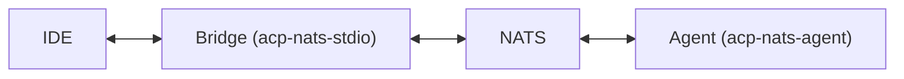

# acp-nats-agent

Server-side framework for building [ACP](https://agentclientprotocol.com/) agents over NATS.

## Architecture



## Usage

Runners implement `acp_nats::AgentHandler`. The SDK uses builder callbacks, so the
bridge owns this trait surface
(see [ADR#0020](../../../../docs/adr/0020-acp-sdk-1x-boundary-and-bridge-traits.md)).
Only `initialize`, `authenticate`, `new_session`, `prompt`, and `cancel` are required; every
other method defaults to `method_not_found`.

```rust,no_run
use acp_nats::{AcpPrefix, AgentHandler};
use acp_nats_agent::AgentSideNatsConnection;
use agent_client_protocol::Result;
use agent_client_protocol::schema::ProtocolVersion;
use agent_client_protocol::v1::schema::{
    AuthenticateRequest, AuthenticateResponse, CancelNotification, InitializeRequest, InitializeResponse,
    NewSessionRequest, NewSessionResponse, PromptRequest, PromptResponse, StopReason,
};

struct MyAgent;

#[async_trait::async_trait]
impl AgentHandler for MyAgent {
    async fn initialize(&self, _args: InitializeRequest) -> Result<InitializeResponse> {
        Ok(InitializeResponse::new(ProtocolVersion::V1))
    }

    async fn authenticate(&self, _args: AuthenticateRequest) -> Result<AuthenticateResponse> {
        Ok(AuthenticateResponse::new())
    }

    async fn new_session(&self, _args: NewSessionRequest) -> Result<NewSessionResponse> {
        Ok(NewSessionResponse::new("session-123"))
    }

    async fn prompt(&self, _args: PromptRequest) -> Result<PromptResponse> {
        Ok(PromptResponse::new(StopReason::EndTurn))
    }

    async fn cancel(&self, _args: CancelNotification) -> Result<()> {
        Ok(())
    }
}

#[tokio::main(flavor = "current_thread")]
async fn main() {
    let nats = async_nats::connect("localhost:4222").await.unwrap();

    let (_connection, io_task) = AgentSideNatsConnection::new(
        MyAgent,
        nats,
        AcpPrefix::new("acp").unwrap(),
        |fut| {
            tokio::task::spawn_local(fut);
        },
    );

    let local = tokio::task::LocalSet::new();
    local.run_until(io_task).await.unwrap();
}
```

## Serving one client

`AgentSideNatsConnection::with_jetstream_gated` puts every request to a
`ClientGate` before the agent sees it. The gate gets the client named in the
request's `X-Acp-Client` header, which the `acp-nats` bridge sets from its
client's `initialize`, or `None` if there is no header. A refused request is
answered with the gate's JSON-RPC error, and a refused notification is
dropped. `acp-host` uses this to serve the one client that claimed it. The
header is a label, not a credential, so the gate guards against a
misconfigured prefix, not a hostile client.

## Stopping without stranding commands

`AgentSideNatsConnection::with_jetstream_gated_until` serves until a `stop`
future resolves. It then stops pulling from `COMMANDS`, nacks every command it
was handed (waiting or in progress, whose work is dropped), and returns, so a
process that is shutting down can flush and close its NATS connection without
leaving commands to wait out the consumer's `ack_wait`. `acp-host` uses it on
SIGTERM.

## Relaying `initialize`

`initialize` reaches the agent through `AgentHandler::initialize_raw`, with the
client's params as sent. Its default reads them as the typed request, which
keeps only the members the ACP schema names. An agent that relays the
handshake to another agent, such as `acp-host`, overrides it to pass the
params on whole.
