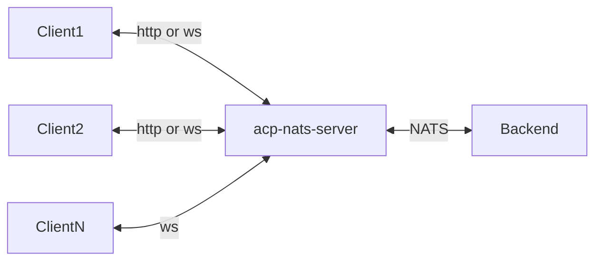

# ACP NATS Streamable HTTP & WebSocket

Translates [Agent Client Protocol](https://agentclientprotocol.com) (ACP) messages between [NATS](https://nats.io) and the draft remote transport served on `/acp`, including both Streamable HTTP (`POST`/`GET`/`DELETE`) and WebSocket upgrade.

For managed NATS infrastructure in production, we recommend <a href="https://synadia.com/?utm_source=trogonai&utm_medium=referral&utm_campaign=trogonai&utm_content=acp-nats-server" rel="noopener"> Synadia</a>.



## Features

- Streamable HTTP transport on `/acp` with connection-scoped and session-scoped SSE streams
- WebSocket upgrade on `/acp`
- Multiple concurrent ACP connections sharing the same NATS bridge
- OpenTelemetry integration (logs, metrics, traces)
- Graceful shutdown (SIGINT/SIGTERM) with per-connection drain
- Custom prefix support for multi-tenancy

## Quick Start

```bash
docker run -d -p 4222:4222 nats:2.10.14 --js

cargo build --release -p acp-nats-server

NATS_TLS_DISABLED=true ./target/release/acp-nats-server provision

NATS_TLS_DISABLED=true ./target/release/acp-nats-server
```

### Provisioning existing deployments

Run the one-shot `provision` command before starting the transport server or
agents. Use the same ACP prefix as those processes and credentials authorized
to manage that prefix's streams:

```bash
NATS_CREDS="$ACP_PROVISIONER_CREDS" ./target/release/acp-nats-server --acp-prefix "$ACP_PREFIX" provision
NATS_CREDS="$ACP_RUNTIME_CREDS" ./target/release/acp-nats-server --acp-prefix "$ACP_PREFIX"
```

The command creates missing streams and reconciles their subject filters,
including filters introduced by ACP upgrades. It retains messages, consumers,
and operator-owned retention and storage settings. An incompatible stream or
denied API operation makes the command exit unsuccessfully; deployment startup
must depend on successful completion. Repeating the command against an unchanged
configuration does not update streams.

Before changing any stream, the command inspects every existing stream for the
prefix and refuses sealed or mirrored streams, which cannot accept the bridge's
direct command publications. It also rejects empty subject lists or filters
outside the exact ACP prefix's protocol namespace, including a stream name
occupied by a different prefix with the same normalized name. During preflight,
only an explicit stream-not-found response is treated as absence; other
inspection or configuration-read failures stop provisioning before any mutation.

Reconciliation then reads each stream again through the shared JetStream client
and checks the live subject filters immediately before an update. A stream whose
subjects are no longer exclusively owned by this prefix is left untouched and
provisioning fails with an ownership error. This closes the overwrite window for
the observed concurrent jobs; JetStream does not provide a conditional stream
update, so a separate process can still change a stream after that check and
before the update.
If that later lookup fails, the client attempts CREATE; an existing stream name
normally makes that request fail. A later reconciliation failure can leave
earlier streams updated. Provisioning is not an atomic transaction across
streams and does not protect against concurrent configuration changes.

Connection setup makes one pass over the configured servers instead of retrying
indefinitely.
The command applies `ACP_OPERATION_TIMEOUT_SECS` to its JetStream API reply
waits, using the existing ACP operation timeout when no override is supplied.

Provisioning credentials need publish permission on the ACP streams'
`$JS.API.STREAM.INFO.<name>`, `$JS.API.STREAM.CREATE.<name>`, and
`$JS.API.STREAM.UPDATE.<name>` API subjects, with subscription permission for
their reply inboxes. Keep those credentials in the provisioning job. Ordinary
server startup uses runtime credentials and does not create or update streams.

### Connecting a client

The transport also needs an ACP backend serving the same prefix. Provisioning
creates the broker streams; it does not start an execution backend.

Connect with any WebSocket client:

```bash
websocat ws://127.0.0.1:8080/acp
```

Or use Streamable HTTP:

```bash
curl -i \
  -H 'Content-Type: application/json' \
  -H 'Accept: application/json, text/event-stream' \
  -d '{"jsonrpc":"2.0","id":1,"method":"initialize","params":{"protocolVersion":1}}' \
  http://127.0.0.1:8080/acp
```

Then open the long-lived SSE stream for the connection:

```bash
curl -N \
  -H 'Accept: text/event-stream' \
  -H 'Acp-Connection-Id: <connection-id>' \
  -H 'Acp-Protocol-Version: <negotiated-version>' \
  http://127.0.0.1:8080/acp
```

`POST /acp` returns `200 OK` with JSON only for `initialize`; follow-up POST requests return `202 Accepted` immediately and their JSON-RPC responses arrive on a `GET /acp` stream. Which stream depends on the message: anything carrying a `sessionId` goes to that session's stream, so a `GET` wanting session traffic (a `session/update`, a `session/load` reply) must send `Acp-Session-Id`; everything else goes to the connection stream. A session-scoped `POST` may send `Acp-Session-Id`, but the session is otherwise recovered from `params.sessionId`. `DELETE /acp` terminates a connection. The WebSocket upgrade response and HTTP initialize response both include `Acp-Connection-Id`; a *failed* `initialize` returns none, since no connection survives it.

Use the `Acp-Connection-Id` response header and the `protocolVersion` returned by
`initialize` in subsequent requests. Each connection or session stream allows
one active SSE reader; opening a duplicate reader returns `409 Conflict`.

After `initialize`, the ACP transport spec says HTTP clients SHOULD send `Acp-Protocol-Version` on `POST`/`GET`/`DELETE`. The server validates it when present and rejects mismatches against the negotiated ACP protocol version for that connection.

When clients send an `Origin` header, `/acp` validates it against the bound host and rejects disallowed origins with `403 Forbidden`. Browser WebSocket upgrades are refused outright: the underlying transport rejects any upgrade carrying an `Origin`. Non-browser clients send none and are unaffected.

## Configuration

### Server

| Variable | CLI Flag | Description | Default |
|----------|----------|-------------|---------|
| `ACP_SERVER_HOST` | `--host` | Listen address | `127.0.0.1` |
| `ACP_SERVER_PORT` | `--port` | Listen port | `8080` |

### ACP

| Variable | Description | Default |
|----------|-------------|---------|
| `ACP_PREFIX` | Subject prefix for multi-tenancy | `acp` |
| `ACP_OPERATION_TIMEOUT_SECS` | Timeout for NATS request/reply operations | built-in default |
| `ACP_PROMPT_TIMEOUT_SECS` | Timeout for prompt round-trips | built-in default |
| `ACP_NATS_CONNECT_TIMEOUT_SECS` | NATS connection timeout | `10` |

CLI flag `--acp-prefix` overrides `ACP_PREFIX`.

### NATS

| Variable | Description | Default |
|----------|-------------|---------|
| `NATS_URL` | Server URL(s), comma-separated for failover | `localhost:4222` |

### NATS Authentication

These variables accept the same values as the `nats` CLI. One method is chosen, first match wins:

| Priority | Variable(s) | Method |
|----------|-------------|--------|
| 1 | `NATS_CREDS` | Credentials file, a path or `file://path` |
| 2 | `NATS_NKEY` | NKey seed, or a seed or `.creds` file as a path or `file://path` |
| 3 | `NATS_USER` + `NATS_PASSWORD` | Username/password |
| 4 | `NATS_TOKEN`, or `NATS_USER` without `NATS_PASSWORD` | Token |
| 5 | `NATS_JWT` + `NATS_SEED` | User JWT signed with the seed |
| 6 | `NATS_JWT` | User JWT with an empty signature |

`NATS_JWT`, `NATS_SEED`, `NATS_PASSWORD` and `NATS_TOKEN` are literals unless they start with `file://path` (file contents, trailing newlines trimmed) or `env://NAME` (value of another variable). The `op`, `nsc` and `data` schemes are rejected at connect time.

If none are set, the connection is unauthenticated.

### NATS TLS

| Variable | Description |
|----------|-------------|
| `NATS_CERT` + `NATS_KEY` | Client certificate and key, paths or `file://path`. Setting only one of them fails the connection. |
| `NATS_CA` | Root CA certificate, a path or `file://path` |
| `NATS_TLS_DISABLED` | Explicit plaintext opt-out for local tests and debugging (`true`, `1`, or `yes`). TLS is enabled by default. |

Setting `NATS_CERT`, `NATS_KEY`, or `NATS_CA` requires TLS.

### Observability

| Variable | Description |
|----------|-------------|
| `RUST_LOG` | Tracing filter directive (default: `info`) |
| `TROGON_LOG_DIR` | Directory for file-based logging |

### OpenTelemetry

Traces, metrics, and logs are exported over HTTP. The following [OTLP environment variables](https://opentelemetry.io/docs/specs/otel/protocol/exporter/) are supported:

| Variable | Description |
|----------|-------------|
| `OTEL_EXPORTER_OTLP_ENDPOINT` | Collector base URL (e.g. `http://localhost:4318`) |
| `OTEL_EXPORTER_OTLP_HEADERS` | Custom headers, comma-separated `key=value` pairs (e.g. auth tokens) |
| `OTEL_EXPORTER_OTLP_TIMEOUT` | Export timeout in milliseconds (default: `10000`) |
| `OTEL_RESOURCE_ATTRIBUTES` | Additional resource attributes, comma-separated `key=value` pairs |

`OTEL_SERVICE_NAME` is hardcoded to `acp-nats-server` and cannot be overridden.
